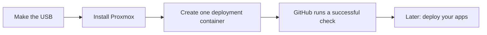

# Build your Proxmox homelab

Start with a custom installation USB, then run a small script from your computer
to create one deployment container on Proxmox. That container connects to your
private GitHub repository so it can run future deployment jobs.

This is aimed at home automation enthusiasts who are comfortable copying terminal
commands and editing a settings file. The guides explain terms as they appear.



## Start here

**Read the [Proxmox guide](proxmox/README.md)** for the whole sequence. It links
to the two practical walkthroughs:

| What you want to do | Guide | What you have at the end |
| --- | --- | --- |
| Prepare and install the host | [Make the installation USB](proxmox/iso/README.md) | Proxmox installed on the selected pair of SSDs, with network and SSH access. |
| Connect the host to GitHub deployment | [Create the first deployment guest](proxmox/bootstrap/README.md) | One small Debian container, an online GitHub runner and a successful verification job. |
| Prepare application deployment | [One-guest application guide](proxmox/applications/README.md) | DNS/database/login foundations, then HA, Node-RED and MQTT. Source tests are distinct from native acceptance. |

The custom installer supports **two new mirrored SSDs, one original disk to
preserve, two wired network ports and tagged VLANs**. Check the guide before
assuming it fits a different computer or home network.

## 1. Get a copy on your computer

You need Git. On a Mac, open **Terminal**, run `git --version`, and follow Apple's
Command Line Tools prompt if one appears. Linux users can install Git through
their distribution's package manager.

Run these commands in Terminal, one at a time:

```sh
git clone https://github.com/theaussiepom/homelab.git
cd homelab
```

You should now see this README and the `proxmox` folder. If you already have a
copy, keep any local work and use a reviewed version; do not clone over it or
discard changes to get a clean folder.

The guides say which folder to use for each command. A **workstation** means the
Mac or Linux computer where you run these commands. The **host** is the machine
that will run Proxmox.

## 2. Follow the Proxmox guide

Continue to the [combined Proxmox guide](proxmox/README.md). Start with its
prerequisites, then follow the installer and bootstrap in order. Each walkthrough
includes expected results and advice for failures.

Keep passwords, private keys, real settings, backups and installation images
private. The examples in this public repository use invented values.

## What is ready?

Status updated on **26 October 2026**, including the physical results from 25 October:

- **Installer and first deployment guest:** the custom ISO was installed on the
  maintainer's physical host. Bootstrap handover reached successful GitHub checks
  on both a fresh lab machine and that host. The physical run needed a tagged-VLAN
  permission fix; the verification record explains the failed attempt and correction.
- **Your installation:** still needs your own disk, network and access checks.
  Another computer's successful installation does not verify yours.
- **DNS and empty database servers:** private GitHub CD has installed and
  checked DNS plus matching PostgreSQL, MariaDB and InfluxDB servers on the
  physical host. Household database restores and later applications remain
  separate work. PegaProx is planned in its own LXC; it is not installed yet.

For the physical run, the initial OpenTofu backup was saved privately on the Mac.
The runner's ongoing NAS state-backup mount and immediate copy/readback have
since passed on the physical host. The [existing-bootstrap update](proxmox/bootstrap/README.md#8-prepare-the-runner-to-deploy-your-applications)
and merge-driven host job have also passed there, including the private backend
bridge and declared database access. These checks cover state copies; restoring
them and protecting live application data remain separate. The linked
verification record also states which NAS security controls were not assessed.
The [Proxmox guide](proxmox/README.md) separates completed and outstanding steps.

See the [ISO verification record](proxmox/iso/verification/README.md) and
[bootstrap verification record](proxmox/bootstrap/verification.md) for exact test
scope, later corrections and remaining limits.

## Checks on GitHub

Open **Actions → Validate HomeLab** to see the source checks in one graph.
Application tests, repository checks and security checks run independently on
GitHub's machines. ISO source tests run on every pull request; the longer ISO
build and virtual boot checks run when installer or validation-workflow inputs
change. The manual entry runs those ISO checks, and the weekly entry runs CodeQL.
These checks use synthetic data and do not deploy to your Proxmox host.

## Other folders

These are separate from the two-step Proxmox setup:

| Folder | Use it for |
| --- | --- |
| [Local site example](examples/site/README.md) | Practise the broader framework using invented data on your computer. It does not deploy real guests. |
| [Database backup](services/database-backup/README.md) | Understand the existing BenBeast backup extension and its dated restore evidence. |
| [Network recovery](services/network-recovery/README.md) | Understand the existing BenBeast-specific network repair service. It is not a generic Proxmox prerequisite. |
| [Contributing safely](docs/contributing-safely.md) | Make code changes, run checks and prepare pull requests. |

The broader framework's full-site Proxmox execution adapter remains held. Its
technical contracts are in [execution](docs/execution.md),
[private-site configuration](docs/configure-private-site.md),
[ownership](docs/ownership-and-lifecycle.md) and [rehearsal](docs/rehearsal.md).
Use the separate [one-container bootstrap](proxmox/bootstrap/README.md) for the
working first-guest path.
