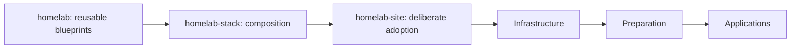

# HomeLab framework

Build a small Proxmox homelab with reusable OpenTofu resources, Ansible preparation
and application blueprints. The executable platform is Debian 13 LXC. VM guests
require separate implementation and qualification.

Three repositories have different jobs:

| Repository | What belongs there |
| --- | --- |
| **homelab** (this one) | Reusable infrastructure, preparation and app blueprints, phase runner and tests |
| **homelab-stack** | Copyable composition: guests, applications, dependencies, images and example topology |
| **homelab-site** (private) | Reviewed stack selection, actual private overrides, Secrets references and deployment controls |



Start with the [stack contract](docs/stack-contract.md), then the stack's README.
[Blueprint definitions](blueprints/catalogue.json) list exactly the supported
guest applications and Linux/Docker capabilities. Ordinary deployment reuses
[the guarded adapter](proxmox/applications/deploy.py), the existing LXC
[module](proxmox/applications/tofu/guest/main.tf) and Ansible tasks.
OpenTofu owns guest CPU/RAM/disks/NICs/firewall/autostart. Ansible owns packages,
Docker/Compose where selected, and applications. A native database omits Docker.

For local source tests, use Python 3.12+ with the pinned dependencies in
[pyproject.toml](pyproject.toml):

```sh
python3 -m venv .venv
. .venv/bin/activate
python3 -m pip install -r requirements.lock.txt
python3 -m pytest -q tests
python3 -m unittest discover -s blueprints
python3 -m unittest discover -s proxmox/applications/tests
ansible-playbook -i localhost, --syntax-check proxmox/applications/ansible/preparation.yml
ansible-playbook -i localhost, --syntax-check proxmox/applications/ansible/reconcile.yml
```

CI requires 100% line and branch coverage for every production Python file in
each repository, and 100% line, branch and function coverage for both Node-RED
helpers. Measure and enforce the complete Python inventory locally:

```sh
export GITLEAKS_BIN=/path/to/verified/gitleaks
python3 tools/measure_coverage.py --all --stack ../homelab-stack --site ../homelab-site --fail-under 100 --output .work/coverage
```

Omit `--fail-under` for an exploratory measurement. CI always supplies the gate.
Stack and site suite reports measure their own code; the framework is measured by
its independent full suite. Use a fresh output directory. The report inventories every tracked production Python
file and local source addition, including scripts that were never imported. It runs
framework, blueprint, application, bootstrap, installer, recovery and source guard
suites, plus stack and private-site tests when supplied. Test source is excluded;
no production file or defensive branch is excluded. Reports contain
per-component and per-file line/branch fractions, missing paths, JSON, Cobertura XML
and HTML. Separate JavaScript coverage uses Node's built-in coverage runner for both
Node-RED helpers. Ansible, shell and OpenTofu require their behavioral/syntax/native
fixtures and do not have Python-style line percentages. Native qualification remains
separate. CI publishes summaries and bounded 14-day Python report artifacts.

`--suite framework`, `--suite blueprints`, `--suite applications`,
`--suite stack --stack PATH` and `--suite site --site PATH` select individual suites.
Use `--all` for the complete Python inventory, including bootstrap, installer,
CI tooling, recovery and the private checker. Failing tests still fail their jobs.

The full application suite includes explicitly gated Docker/native fixtures;
read its skips and prerequisites. These tests are not target qualification.
[Bootstrap and recovery reference](docs/framework-reference.md)
remain available for separately approved work. Source changes run CI only; live
rollouts require a reviewed private-site adoption. No credential values, application
data, custom images or radio identities belong in any source repository.
