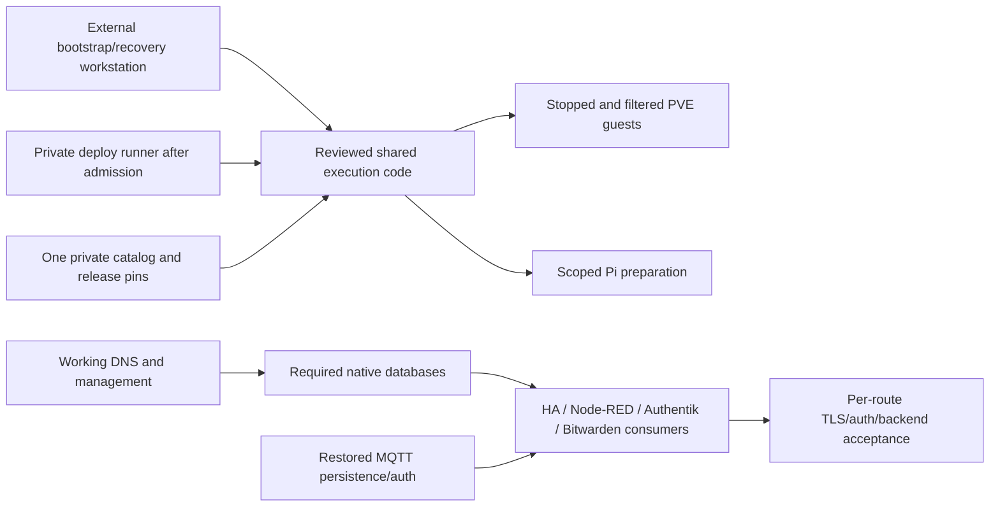

# Ownership, identity and lifecycle contract

Preserve actual existing numeric process UID/GID values and each dataset's separate numeric owners/groups, modes and supported ACLs/xattrs. No service renumbering, shared configuration group, source/staged ownership conversion or migration chown is selected. An unprivileged LXC namespace still needs a recorded/qualified guest-to-PVE subordinate map while keeping logical application IDs. Existing separately completed handoffs are observed, not reverted to an older research candidate.

For native packages, a fresh guest's service account must match the preserved identity before data restore and package-script behavior is qualified. A package default/collision is a hold, not an automatic account conversion. `homelab_identity_guard` checks bound account/path metadata and refuses a mismatch; an empty verification manifest cannot produce a pass. The generic mount guard also refuses wrong source/UUID/filesystem/owner or an empty unmounted directory and has no repair/init path.

OpenTofu owns guest virtual hardware and supported primary LXC network generation; Ansible owns separately named route/filter/native settings and deployment declarations. Ansible must not install a competing network manager or rewrite PVE-generated primary files. VM cloud-init owns a frozen birth record; post-handover live VM routing belongs to its admitted Ansible owner. Physical Pi NetworkManager has its own owner. Unsupported provider fields remain gates; do not add overlapping provisioners or shell writers.

Live HA/Node-RED source/private state remains application/editor-owned. The declaration-staging role writes only its dedicated deployment directory and does not template over that source or start containers. Native package staging requires a qualified new-guest policy; disabling Debian service autostart alone does not qualify every package's cluster-creation scripts. No role changes application data ownership to solve a failure.

All guests are initially protected/stopped and off at boot. Their native PVE boot and per-service readiness/drain/hold behavior is admitted later. Exact guest allow rules and host/datacenter firewall policy are still required before starting writers; DROP-by-default skeletons are not working application connectivity. Holds/drains, source identities, real database flush/broker persistence and the sole conditional Scrypted missing-storage boot release need target qualification. Root creation order does not prove service readiness.

Applications, native boot/shutdown and accepted Pi timers continue independently of deployment/GitHub availability. New target writes require a fresh coherent recovery generation before rebuild or transfer-back. No old Ubuntu boot disk remains after the selected SSD is erased.
