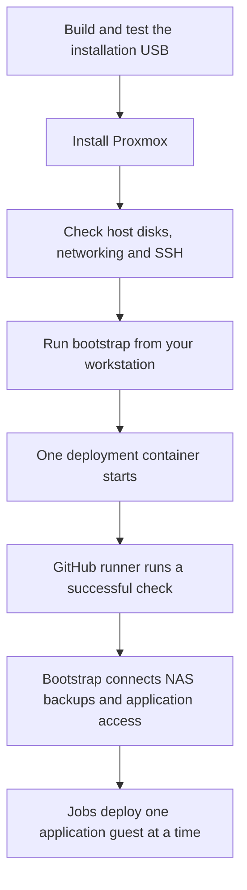

# Proxmox: from installation USB to GitHub deployment

[Back to the main README](../README.md)

The goal is a freshly installed Proxmox machine with one small deployment
container ready to run jobs from your private GitHub repository.

A **guest** is a container or virtual machine hosted by Proxmox. This bootstrap
creates a Debian container. A **runner** is the service inside it that receives
and runs GitHub jobs. **CD**, or continuous deployment, means using those jobs to
make reviewed changes to your homelab.

## Does this fit your setup?

The installer supports **two new mirrored SSDs, one preserved original disk,
two wired network ports and UEFI boot**. Both ports use tagged VLANs: numbered
networks that your switch must already carry. A different layout needs a
supported design; changing example values alone is not enough.

You also need:

- A Mac or Linux workstation, with a [copy of this repository](../README.md#1-get-a-copy-on-your-computer).
- Docker running; on a Mac, use Docker Desktop with Linux containers. Apple
  Silicon Macs use x86-64 emulation for these tools.
- A private GitHub repository that you administer, and GitHub CLI (`gh`) signed
  in on your workstation, for the bootstrap stage.
- Your chosen management/storage addresses, VLANs and matching switch setup.
- A password manager for the recovery password and SSH key.

Before switching off an existing server, make sure you can retrieve those
credentials while it is off. This matters if it also hosts your password manager.

The [ISO guide](iso/README.md#what-you-need) lists download, disk-space and USB
requirements. The [bootstrap guide](bootstrap/README.md#what-you-need) lists
its additional tools. Windows is not covered by these walkthroughs.

## 1. Make the installation USB

Follow the [installation USB guide](iso/README.md). Start with its safe practice
run, supply your own hardware/settings, then build, test and write the real image.

**Expected result:** a USB whose complete image has been read back and verified,
with `usb_ready: true` and `ejected: true`. You can then unplug it.

The USB starts in **CHECK ONLY**. Installing requires choosing **INSTALL** and
confirming the selected drive serial numbers. Installation erases those two new
SSDs. Choose the interruption to your existing system separately.

## 2. Install and check the host

Use [the ISO guide's installation steps](iso/README.md#6-boot-and-install--at-your-chosen-maintenance-window).
After installation, check the host from its local keyboard/screen and your
workstation using [host access and checks](host-access.md).

**Expected result:** the intended Proxmox host is reachable, its mirror is
healthy, the original disk remains separate, both network ports match their
settings, and SSH works with the key you included in the ISO.

Do not continue with guest creation if a host check fails. The installation
has not yet created a guest or connected anything to GitHub.

## 3. Create the first guest and connect GitHub

Follow the [bootstrap guide](bootstrap/README.md). Run its commands on your
workstation. OpenTofu and Ansible run inside Docker, not on the Proxmox host.

The scripts upload the selected template when needed, create a scoped Proxmox
API token, create one container, add its host API firewall allowance, install
the runner and transfer its state. You do not need a separate base-guest script
or manual token/firewall setup in the Proxmox web interface.

Before running the host-changing steps, review the selected guest/storage
privileges, guest-to-host TCP 8006 endpoints, runner workflow trust and state
handover described in the [bootstrap operating reference](bootstrap/OPERATIONS.md).
Confirm these are the access you intend to grant. A scoped token still grants
real administrative permissions; its scope alone is not a least-privilege guarantee.

**Expected result:** one guest running, a runner online in your private GitHub
repository, and a successful GitHub job reporting a no-change OpenTofu plan.
This confirms that GitHub can manage the guest using the transferred state.

The runner is a service **inside the deployment guest**. GitHub lists it in the
private repository named in your settings. This public `homelab` repository holds
the reusable scripts and guides; the private deployment repository holds your
reviewed jobs and site settings. Credentials stay private.

**State** is OpenTofu's private record of what it created. No PostgreSQL or other
database is required. After handover, the runner owns the active state; keep
recovery copies safe and do not run a second active copy from your workstation.

## 4. Continue with application deployment

For merge-driven host prerequisites, follow [bootstrap step 9](bootstrap/README.md#9-let-github-maintain-the-host-prerequisites).
It prepares the private backend bridge and the declared application permissions
without reinstalling the host. Application CD then creates and configures each guest.

The initial setup ends at the successful GitHub check. The
[application guide](applications/README.md) covers the next source path: one
OpenTofu guest, Ansible staging, then an explicit application start and check.
DNS, native databases and login/proxy foundations come before the shared
Home Assistant, Node-RED and MQTT guest. DNS and the three empty native database
servers have passed CD installation/checks on the maintainer's host. Database
restores, later apps and household acceptance remain outstanding; bootstrap
does not migrate those services itself.

[PegaProx has its own planned LXC](applications/pegaprox.md). It remains separate
from the runner and is not an HA prerequisite. Its installation is not yet
implemented.

Before creating more guests, finish the runner's ongoing NAS state backup and
review access for the next guest using
[bootstrap step 8](bootstrap/README.md#8-prepare-the-runner-to-deploy-your-applications).
Already installed? Start at that step; it updates the existing deployment guest
without reinstalling Proxmox or creating another runner.
The bootstrap token covers its first guest;
it does not automatically grant permission to create the rest of the homelab.

If you boot back into a preserved original operating system, Proxmox and its
guests are off. The runner will show offline until you boot Proxmox again.
Household services on the original system and their new replacements need their
own checks before you rely on them.

## When something goes wrong

| What you see | What to do |
| --- | --- |
| Your disk, port or VLAN layout differs | Check the supported layout before building. Do not guess settings to make it pass. |
| A build, test or USB check fails | Use the [ISO troubleshooting table](iso/README.md#when-something-goes-wrong). |
| The installed host is unreachable | Work through [host access and checks](host-access.md) at its local console. |
| Bootstrap stops, times out or leaves a hold | Use the [bootstrap troubleshooting table](bootstrap/README.md#when-something-goes-wrong); keep the files and inspect the outcome before retrying. |
| Runner is online but the job is queued | Check the workflow's runner labels against [the final bootstrap step](bootstrap/README.md#7-confirm-github-has-taken-over). |

## What has actually been verified?

Status updated on **26 October 2026**, including the physical results from 25 October:

| Stage | Established | Still outstanding |
| --- | --- | --- |
| Installer | Packaged virtual checks plus a physical installation with a healthy two-drive mirror, separate original disk and working first-start access. | Each new machine needs its own checks; repeated physical restart behaviour is not established by that first start. See [ISO verification](iso/verification/README.md). |
| Bootstrap | Clean lab handover, then a corrected physical handover. On 26 October the physical runner also passed NAS state recovery, application-access configuration and merge-driven host checks for the private backend bridge/database grants. | Each new host needs its own checks; state recovery does not protect live application data. See [bootstrap verification](bootstrap/verification.md#physical-nas-and-database-foundation-passed-on-26-october-2026). |
| PegaProx | Decision recorded: a separate management LXC. | Guest sizing/address, reviewed access, CD jobs, installation and actual use checks. See the [application plan](applications/README.md). |
| DNS and database servers | DNS and the three empty native database servers passed deployment/checks; a normal follow-up CD run verified the database servers without reinstallation or restart. | Household database restores, real application clients and a post-install host reboot. See [databases](applications/DATABASES.md). |
| Household applications | Deployment source is prepared for later guests. | Guest-by-guest deployment and application acceptance. |

Physical installation and first-start networking are part of the actual migration.
They are separate from software-only tests. Keep real
credentials, settings, state, plans and installation media outside Git.
