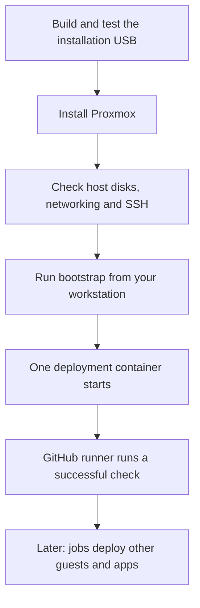

# Proxmox: from installation USB to GitHub deployment

[Back to the main README](../README.md)

The goal is a freshly installed Proxmox machine with one small deployment
container ready to run jobs from your private GitHub repository.

A **guest** is a container or virtual machine hosted by Proxmox. This bootstrap
creates a Debian container. A **runner** is the service inside it that receives
and runs GitHub jobs. **CD**, or continuous deployment, means using those jobs to
make reviewed changes to your homelab.

## Does this fit your setup?

The installer supports **two new mirrored SSDs, one preserved original disk,
two wired network ports and UEFI boot**. Both ports use tagged VLANs: numbered
networks that your switch must already carry. A different layout needs a
supported design; changing example values alone is not enough.

You also need:

- A Mac or Linux workstation, with a [copy of this repository](../README.md#1-get-a-copy-on-your-computer).
- Docker running; on a Mac, use Docker Desktop with Linux containers. Apple
  Silicon Macs use x86-64 emulation for these tools.
- A private GitHub repository that you administer, and GitHub CLI (`gh`) signed
  in on your workstation, for the bootstrap stage.
- Your chosen management/storage addresses, VLANs and matching switch setup.
- A password manager for the recovery password and SSH key.

The [ISO guide](iso/README.md#what-you-need) lists download, disk-space and USB
requirements. The [bootstrap guide](bootstrap/README.md#what-you-need) lists
its additional tools. Windows is not covered by these walkthroughs.

## 1. Make the installation USB

Follow the [installation USB guide](iso/README.md). Start with its safe practice
run, supply your own hardware/settings, then build, test and write the real image.

**Expected result:** a USB whose complete image has been read back and verified,
with `usb_ready: true` and `ejected: true`. You can then unplug it.

The USB starts in **CHECK ONLY**. Installing requires choosing **INSTALL** and
confirming the selected drive serial numbers. Installation erases those two new
SSDs. Choose the interruption to your existing system separately.

## 2. Install and check the host

Use [the ISO guide's installation steps](iso/README.md#6-boot-and-install--at-your-chosen-maintenance-window).
After installation, check the host from its local keyboard/screen and your
workstation using [host access and checks](host-access.md).

**Expected result:** the intended Proxmox host is reachable, its mirror is
healthy, the original disk remains separate, both network ports match their
settings, and SSH works with the key you included in the ISO.

Do not continue with guest creation if a host check fails. The installation
has not yet created a guest or connected anything to GitHub.

## 3. Create the first guest and connect GitHub

Follow the [bootstrap guide](bootstrap/README.md). Run its commands on your
workstation. OpenTofu and Ansible run inside Docker, not on the Proxmox host.

The scripts upload the selected template when needed, create a scoped Proxmox
API token, create one container, add its host API firewall allowance, install
the runner and transfer its state. You do not need a separate base-guest script
or manual token/firewall setup in the Proxmox web interface.

**Expected result:** one guest running, a runner online in your private GitHub
repository, and a successful GitHub job reporting a no-change OpenTofu plan.
This confirms that GitHub can manage the guest using the transferred state.

**State** is OpenTofu's private record of what it created. No PostgreSQL or other
database is required. After handover, the runner owns the active state; keep
recovery copies safe and do not run a second active copy from your workstation.

## 4. Continue with application deployment

The initial setup ends at the successful GitHub check. Further OpenTofu jobs
create other guests; Ansible jobs install/configure their applications. Those
jobs and application acceptance are later work. The bootstrap does not migrate
Home Assistant, databases or NAS data into new applications.

## When something goes wrong

| What you see | What to do |
| --- | --- |
| Your disk, port or VLAN layout differs | Check the supported layout before building. Do not guess settings to make it pass. |
| A build, test or USB check fails | Use the [ISO troubleshooting table](iso/README.md#when-something-goes-wrong). |
| The installed host is unreachable | Work through [host access and checks](host-access.md) at its local console. |
| Bootstrap stops, times out or leaves a hold | Use the [bootstrap troubleshooting table](bootstrap/README.md#when-something-goes-wrong); keep the files and inspect the outcome before retrying. |
| Runner is online but the job is queued | Check the workflow's runner labels against [the final bootstrap step](bootstrap/README.md#7-confirm-github-has-taken-over). |

## What has actually been verified?

Status recorded on **25 October 2026**:

| Stage | Established | Still outstanding |
| --- | --- | --- |
| Installer | Packaged build workflow, source tests and six accepted virtual boot checks. | Physical installation and first-start networking on the intended machine. See [ISO verification](iso/verification/README.md). |
| Bootstrap | Fresh isolated Proxmox 9.2 → one container → private runner → successful real GitHub job with matching state, without manual repairs between stages. Later review corrections passed offline checks. | Physical-target acceptance, ongoing address/credential policy and independent NAS state-backup commissioning. See [bootstrap verification](bootstrap/verification.md). |
| Later guests and applications | The runner provides the starting point for subsequent deployment jobs. | Full-estate deployment and application acceptance. |

Physical installation and first-start networking are part of the actual migration.
They are separate from completing the installer and bootstrap tooling. Keep real
credentials, settings, state, plans and installation media outside Git.
