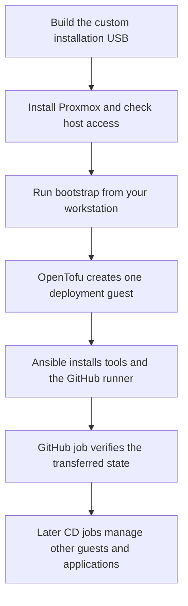

# Proxmox: from installation USB to GitHub deployment

[Back to the main README](../README.md)

The goal is a freshly installed Proxmox machine with one small deployment guest
ready to run jobs from your private GitHub repository. A **guest** is a container
or virtual machine hosted by Proxmox. This bootstrap creates a Debian container.
A **runner** is the service inside it that receives and runs GitHub jobs.

Start here, then follow the detailed guide for the stage you need. You do not
need a separate script to create base guests before OpenTofu.

## 1. Install Proxmox

Follow the [installation USB guide](iso/README.md). It covers the supported
hardware layout, private settings, Docker build tools, practice tests, USB
writing and attended installation.

The installer prepares the host's disks, networking and SSH access. It does
not create the deployment guest. Before continuing, confirm the installed
host's storage, network and SSH access using that guide.

**Supported layout:** two new mirrored SSDs, one preserved original disk, two
wired network ports and UEFI boot. A different layout needs a supported design;
changing the example values alone is not sufficient.

## 2. Create the deployment guest and hand over to GitHub

Follow the [bootstrap guide](bootstrap/README.md). Run it from your Mac or Linux
workstation with Docker and an authenticated GitHub CLI. OpenTofu and Ansible
run inside Docker, not on the Proxmox host.

The bootstrap:

1. Uses the host's verified SSH connection to upload a checksum-pinned template
   when needed and create a narrowly scoped Proxmox API token.
2. Uses a saved OpenTofu plan to create and start one small Debian guest.
3. Adds the guest's required API-only allowance in the Proxmox host firewall.
4. Uses Ansible to install deployment tools and the private GitHub runner.
5. Transfers the exact OpenTofu state to the guest and freezes the workstation
   copy. A real GitHub job must then confirm a no-change plan on that runner.

There is no PostgreSQL requirement. **State** is the private file OpenTofu uses
to track the guest it created. Keep its backup safe; after handover, the runner
owns the active copy.

The host storage, bridge and network must already exist. The bootstrap scripts
the template, API-token and host-firewall steps; it does not require manual
Proxmox web-interface configuration for those steps. You still supply your
private settings and verify the fresh host's SSH fingerprint.

## What is ready, and what still needs proving?

Status recorded on **25 October 2026**. The linked verification records contain
the evidence and limits; this overview does not replace them.

| Stage | Established | Still outstanding |
| --- | --- | --- |
| Installation USB | Packaged build instructions, source tests and six accepted virtual boot checks. | Physical installation and first-start networking on the intended machine. See [ISO verification](iso/verification/README.md). |
| Deployment bootstrap | Fresh isolated Proxmox 9.2 test passed: automatic template/token setup, guest creation, API firewall allowance, state handover and a successful real GitHub job on the new runner, using unchanged source and no manual repairs between stages. | Physical-target acceptance, ongoing address/credential policy and independent NAS state-backup commissioning. See [bootstrap verification](bootstrap/verification.md). |
| Later guest and application CD | The deployment runner is the intended starting point for subsequent OpenTofu and Ansible jobs. | Full-estate deployment and application acceptance are not established by this bootstrap. |

The completed isolated bootstrap milestone is deliberately small: **fresh
Proxmox → run bootstrap → guest running → private runner online → successful
GitHub job with the same state**. Additional service rollout is a later stage.

Physical installation and first-start networking are steps in the actual
migration. They are separate from completing the installer and bootstrap tooling.

## Where to find things

| Guide | Use it for |
| --- | --- |
| [Installation USB](iso/README.md) | Building, testing, writing and installing the custom ISO. |
| [Bootstrap](bootstrap/README.md) | Private settings and commands to create the first guest and connect GitHub. |
| [ISO verification](iso/verification/README.md) | What installer checks passed and what remains unverified. |
| [Bootstrap verification](bootstrap/verification.md) | Local checks, the successful fresh-machine test and its limits. |

Keep real credentials, private settings, state, plans and installation media
outside Git. The public examples are starting points, not your site's ready-made
configuration.
