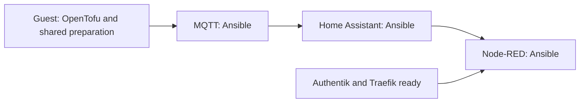

# Home Assistant, Node-RED and MQTT

[Application guide](README.md) · [HTTPS and sign-in](FOUNDATION.md)

These three applications share **one automation LXC**, with a separate Docker
container for each. Zigbee and other radio services keep their existing hosts.
Home Assistant keeps its own login. Node-RED keeps its existing Authentik login.

## What you will see in Actions

The deployment keeps one permanent job named for the guest and ID. It contains
visible OpenTofu, MQTT, Home Assistant and Node-RED steps:

The OpenTofu step creates a missing guest or reconciles its approved safe desired
infrastructure through the existing backend. The application steps reuse the
shared Ansible tasks and start only their selected service. Node-RED follows HA
because its selected flows use it. Matching completed inputs/state return
unchanged; a new approved configuration can converge through the same job.

One-time data restoration, HA configuration preparation and existing-guest
prerequisites belong to the separate reviewed migration procedure. Prepare the
admitted application data, original image exports, narrow ingress permissions,
existing Node-RED callback and broker DNS before enabling this normal job. The
normal workflow requires their recorded completion; it does not run migration
helpers, restore a capture or modify the HA HTTP store.

Independent ready guest jobs can use admitted runner slots in parallel. The
parent owns the queue and actual dependency edges. Within one shared guest, its
ordered service steps keep one operation binding. An interruption or failure
stays held; another run cannot replay it. Completing migration never removes the
permanent deploy job. See [ordinary deployment](ORDINARY.md).

This code is preparation until the private site enables its job with reviewed
inputs. A green source test is not proof that the restored house works.

## Keep your settings and data

Public HomeLab provides the deployment code and input structure. The private
site provides one `automation/deployment.json`, plus an independent immutable
`automation/source.json` source lock. The deployment file contains:

- `schema`: `homelab-automation-deployment-v1`.
- `enabled`: an explicit boolean. Keep it false while preparing and reviewing.
- `discovery_previous_guests`: the exact existing Proxmox discovery scope.
- `site`: the existing application installer profile, including one guest, its
  interfaces, resources and firewall allowances. A retained capture reference is
  historical migration provenance; ordinary deployment strips it from its inputs.
- `stack`: the three services, image identities, resource limits and saved mounts.

Use GitHub Secret `AUTOMATION_NODE_RED_API_TOKEN` for the existing Node-RED API
token. It becomes a private runner input, never a value in Git or Proxmox Notes.
Node-RED's encryption key, OIDC client secret, flows and palette stay in the
private saved data. MQTT retains its password file and persistent messages.

The ordinary adapter checks an OpenTofu plan limited to the selected guest and
its firewall. It refuses adoption, replacement, recreation from missing state,
data-volume changes and unexpected drift. It preserves historical installation
inputs and receipts. Original custom images remain hash-verified when loaded.

The optional `extra_hosts` service map preserves old Docker database names while
pointing them at the selected new server. This avoids rewriting passwords or
sprinkling addresses throughout application configuration.

### Connect to the databases

If your site gives each database its own private Proxmox bridge, keep its
addresses and approved clients in one shared catalogue. The private site can
use the shared `database_networks.py` helper from a separately pinned revision
to append the required network cards and narrow firewall rules. This does not
require updating an already selected application installer or its source lock.

Keep the guest's original network cards in order. Append only the database
connections it needs, and keep HTTP/MQTT networking separate. For this site,
automation needs the planned MariaDB and InfluxDB connections; it has no
PostgreSQL membership. Preserve the existing HA Recorder hostname with an
`extra_hosts` alias whose address comes from the catalogue. Check the current
Node-RED flows before adding other aliases: having a database module installed
does not establish an actual connection.

All four steps must consume the same effective deployment settings. A missing or
changed catalogue stops preparation. Rendering those settings does not create
bridges, migrate a database, rewrite HA settings or prove an app can connect.
Those prerequisites must be ready before enabling deployment.

## Keep the existing Node-RED login

For an existing native Authentik OIDC setup, use `node_red_login: oidc` in the
[routing input](examples/automation.routes.example.json). The application profile
must declare `node_red_authentication: authentik-oidc`. Traefik then forwards to
Node-RED's own login, without adding a second proxy authentication layer.

A stack's optional `node_red_oidc` contains `identity_url`, `node_red_url`,
`client_id` and `provider_slug`. Both URLs are HTTPS origins. The supplied
`node-red-settings.js` wrapper loads the restored settings, moves these OIDC
endpoints and replaces the former Docker-only listener with the guest listener.
The guest firewall restricts access. It preserves the credential secret, access policy,
API-token checks and modules. The existing Authentik provider must also allow
the new `/auth/strategy/callback/` URL through its reviewed configuration step.

A proxy-login routing mode remains supported for sites that already use it. It
requires its declared middleware and embedded-outpost callback. Do not add that
mode to a site whose existing Node-RED already uses native OIDC.

The routes use the same Proxmox Notes discovery as the foundation guests. A
routing preview deliberately reports `deployable: false`: it adds no firewall
allowance, DNS record, discovery permission or application configuration.

For a guest with both a frontend and a Home interface, use the existing
`frontend_routing` settings to keep replies on the interface that received the
connection. The same routing helper used for Traefik runs before Docker. Each
application step checks the prepared route before starting its service.

`automation_configuration.py` derives the new bootstrap guest/VLAN grants from
the application profile. Its discovery extension adds only the selected guest
to the existing read-only token; it does not replace that token or change its
role. Pass the already composed bootstrap configuration with `--bootstrap` so
previous guests and their scoped access are retained. The extension is bound to
that current owner's hash, and bootstrap CD checks it against the actual retained
owner before changing access. Normal application runs validate their foundation
bindings without proposing the historical bootstrap extension again.

With Automation explicitly selected, the site's existing Bootstrap job derives
its grants from the same canonical database-bound guest configuration. Its DNS
job uses `--dns-only` to add the central MQTT record while preserving the selected
zones. Neither operation implicitly changes the selected source pins. Explicitly
release a reviewed host configurator that supports the selected network-grant
fields; this does not reinstall the protected runner guest. Keep commissioned
DNS/database/application guest pins unchanged. Disabled Automation leaves those
jobs' desired settings unchanged.

Port the original files through the existing staging boundary first. Apply
required service configuration separately through SSH while HA remains stopped,
before its normal start. Secrets and centrally managed IP/domain bindings use
their existing private/site mechanisms. CD does not convert HA HTTP storage or
rewrite Zigbee configuration. The normal job starts the chosen
image and does not rewrite `configuration.yaml`, the `.storage/http` settings, trusted proxies
or sensor configuration. Old inputs containing `ha_http` are rejected before
target actions. Agree how to prepare and verify the new listener and proxy
settings before enabling deployment; source tests do not settle that decision.

## Before switching the house

1. Check the actual guest addresses and the networks needed by existing devices.
2. Capture HA, Node-RED and MQTT while their original writers are stopped.
   Preserve owners, permissions, links, private credentials and custom images.
3. Restore HA's existing MariaDB Recorder database separately from server CD.
   Creating an empty MariaDB server does not migrate its history.
   Agree the separate HA configuration conversion strategy and verify its
   prepared backup before enabling the deployment.
4. Review the endpoint, discovery, login and firewall changes together. Resolve
   local Bluetooth/DBus explicitly;
   never expose the Proxmox host's control sockets as a shortcut.
5. At cutover, protect new application writes on the NAS, then verify MQTT, HA, Node-RED,
   Zigbee and real household actions together.

Do not copy the old broken Avahi socket mount. Starting the containers is one
checkpoint; device discovery, restored history and working household controls
still need their own evidence.

## First rollout through the permanent job

The reusable Automation job defaults `application_ready` to false. Its guest
step calls ordinary infrastructure with `--infrastructure-only`; MQTT, HA and
Node-RED steps are explicitly skipped. A fully successful transaction records
`ordinary-infrastructure-ready.json` with its input binding and current backend
state hash, then closes only its own active hold. It does not write
`ordinary-complete.json`, restore data, claim prerequisite service readiness or
start applications. Failed or unknown holds remain held without replay.

Use the separately approved SSH window to verify the new guest identity and
empty managed data child, restore the selected guest-only stage archive with
its exact hash/metadata, recreate the two preserved original links, and apply
required stopped-HA HTTP settings. Preserve originals and record readback.
Check the selected Authentik callback separately over SSH using actual current
custody. Actual DB32 authentication remains unverified until normal HA startup
and Recorder/history acceptance; no extra pre-start SQL client is required. Keep the current firewall posture: stored
peer rules are not proof of effective enforcement. Do not replay the legacy
cross-guest whole-state prerequisite utility or relabel old receipts as current.
Unexpected source/state/identity/holds stop the operation.

Only after that evidence is reviewed, merge the real private parent change
`application_ready: false` to `true`. This ordinary source change triggers the
existing parent workflow; no manual Actions run or Mac/host OpenTofu is needed.
The guest step checks the exact prepared backend, makes a fresh normal plan and
then the ordered MQTT, HA and Node-RED steps run with the existing guards. A
prepared-infrastructure receipt cannot stand in for application completion.
DNS records and ingress declarations alone do not establish service health.

Ordinary Automation does not gate installation on the historical whole-state
prerequisite receipts of other guests, including its first application run.
Those utilities and evidence remain preserved for their historical paths. The
explicitly reviewed application-readiness merge follows the separate data, SSH and
OIDC checks. This guest's own plans, state, locks, failure holds and actual
application health remain mandatory on every ordinary run.
