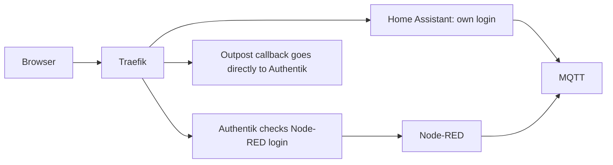

# Home Assistant, Node-RED and MQTT

[Application guide](README.md) · [HTTPS and sign-in](FOUNDATION.md)

These three services share **one automation LXC**, with a separate Docker
container for each application. Existing Zigbee and other radio services keep
their own hosts. Home Assistant keeps its own login. Node-RED uses Authentik.

The common OpenTofu/Ansible installer already supports the three containers,
restored numeric file owners, original custom images and the HA startup helper.
That is reusable deployment code, not a completed site migration. Do not enable
the private automation job until its real guest, data and access inputs are ready.

## Keep settings in one place

Public HomeLab owns the configuration structure and routing/compiler code. Your
private deployment repository owns the actual guest ID, addresses, hostnames,
capture references and source lock. Passwords and application state stay private;
do not paste them into these examples or Proxmox Notes.

Copy [the routing example](examples/automation.routes.example.json) into your
private repository. Enter the automation backend address once. The foundation
site file already supplies the Authentik backend and proxy frontend addresses.
Preview the required wiring without contacting any service:

```sh
python3 public-source/proxmox/applications/automation_routes.py \
  --foundation foundation/site.json \
  --config automation/routes.json \
  --output /tmp/automation-routing-preview.json
```

Choose a new output filename. The result deliberately says `deployable: false`:
it describes the routing changes; it is not a guest deployment input. It adds no
access, writes no application files and does not activate the disabled job.

## How login and routing fit together



The new route compiler uses the same **Proxmox Notes labels** as the foundation
services. For automation it supports these typed routes:

- `homeassistant`: its backend8123, with its own login.
- `node-red`: its backend1880, requiring `login: authentik`.
- `node-red-outpost`: on the identity guest, using `login: outpost`. Only
  `/outpost.goauthentik.io/` on the Node-RED hostname goes to this callback route.

Node-RED uses `authentik@file` in the generated middleware list. Its ingress
configuration needs the optional `foundation.authentik_url`, pointing to the
selected private Authentik backend on port9000. This generates the middleware;
it contains no token. Callback priority100 outranks application priority10 and
does not invoke forward-auth again. HA, Authentik and pgAdmin do not get that gate.

The routing preview derives the required proxy backend rules, discovery guest
list, DNS records and certificate-challenge names from the same inputs. These
are proposed additions to the reviewed CD configuration, not permission to apply
them. It does not replace existing foundation inputs or bypass their saved-input
checks. Updating an already deployed foundation needs its normal reviewed update
path; an unchanged-input verification job cannot install these additions.

Keep the existing Node-RED provider and its policies. Reconcile its external
hostname and the embedded outpost's full Authentik URL through the reviewed
application configuration step. Restoring the database preserves old settings;
it does not rewrite them to the new network. No extra outpost container, Docker
socket, new administrator or API token is required by this design. See
[Authentik's embedded outpost](https://docs.goauthentik.io/add-secure-apps/outposts/embedded/)
and [Traefik pattern](https://docs.goauthentik.io/add-secure-apps/providers/proxy/server_traefik/).

## What still needs preparing before deployment

1. Complete the automation guest's interfaces, resource budget and allowed
   traffic. Restrict HA/Node-RED web ports to the proxy and admitted administration;
   protecting a hostname does not protect a separately exposed backend port.
2. Supply a coherent HA/Node-RED/MQTT capture and checksum-verified archives of
   the original custom HA and Node-RED images. Preserve helpers, modules, flows,
   credentials and MQTT retained/durable state. Do not substitute generic images.
3. Adapt captured application endpoints to the new databases, broker and proxy.
   Retain HA's trusted-proxy settings. Resolve any raw InfluxDB-directory and
   DBus dependencies explicitly; do not silently drop those mounts. Never restore
   the broken Avahi socket mount.
4. Wire the proposed Notes, middleware, outpost/provider and DNS changes into the
   normal CD path. Synthetic Notes/login tests prove the route mechanism, not
   the restored provider, a browser login or Docker inside the final LXC.
5. Protect new writes on the NAS and retire the old writers during the selected
   migration window before the new copy starts. Then verify HA, Node-RED, MQTT,
   Zigbee and real household automations together.

Database restoration remains separate from server CD. HA uses the existing
MariaDB Recorder configuration; MQTT is the existing broker with authentication,
not a newly opened anonymous broker. Do not move physical radios as a side effect.
