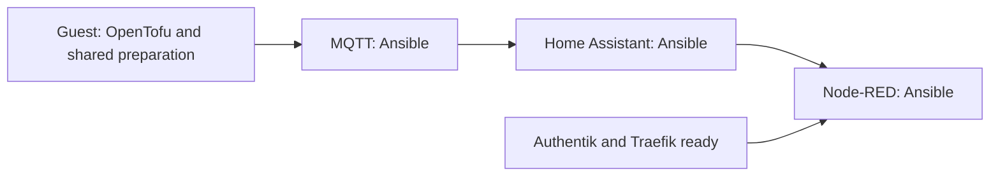

# Home Assistant, Node-RED and MQTT

[Application guide](README.md) · [HTTPS and sign-in](FOUNDATION.md)

These three applications share **one automation LXC**, with a separate Docker
container for each. Zigbee and other radio services keep their existing hosts.
Home Assistant keeps its own login. Node-RED keeps its existing Authentik login.

## What you will see in Actions

The deployment groups four jobs under the guest's name and ID:

Guest setup creates the LXC, checks its identity, waits for its networks, installs
Docker and restores its saved data and original custom images. It prepares the
shared Compose file once, **without starting the applications**.

The same job first completes the declared prerequisites: Traefik's narrow access
to the new guest, the existing Node-RED login callback, and the broker's DNS name.
Their private `automation/maintenance.json` records select the existing guests and
completed installation evidence. Those installation sources remain pinned.

Each later job starts and checks only its named application. Node-RED waits for
HA because the selected flows use it. Independent guest jobs can run at the same
time when runner capacity permits; changes within this shared guest use one lock.
An interrupted or failed operation stays held for review. Rerunning Actions does
not retry it. A later unchanged successful deployment only checks the prepared
guest and services; it does not restore data or recreate their containers.

This code is preparation until the private site enables its job with reviewed
inputs. A green source test is not proof that the restored house works.

## Keep your settings and data

Public HomeLab provides the deployment code and input structure. The private
site provides one `automation/deployment.json`, plus an independent immutable
`automation/source.json` source lock. The deployment file contains:

- `schema`: `homelab-automation-deployment-v1`.
- `enabled`: an explicit boolean. Keep it false while preparing and reviewing.
- `discovery_previous_guests`: the exact existing Proxmox discovery scope.
- `site`: the existing application installer profile, including one guest, its
  interfaces, resources, firewall allowances and verified capture reference.
- `stack`: the three services, image identities, resource limits and saved mounts.

Use GitHub Secret `AUTOMATION_NODE_RED_API_TOKEN` for the existing Node-RED API
token. It becomes a private runner input, never a value in Git or Proxmox Notes.
Node-RED's encryption key, OIDC client secret, flows and palette stay in the
private saved data. MQTT retains its password file and persistent messages.

Before creation, the installer checks the exact saved OpenTofu plan, capture and
original image archives. It creates only the selected new guest and its firewall.
It refuses to adopt an existing guest or overwrite a changed input bundle.

The optional `extra_hosts` service map preserves old Docker database names while
pointing them at the selected new server. This avoids rewriting passwords or
sprinkling addresses throughout application configuration.

## Keep the existing Node-RED login

For an existing native Authentik OIDC setup, use `node_red_login: oidc` in the
[routing input](examples/automation.routes.example.json). The application profile
must declare `node_red_authentication: authentik-oidc`. Traefik then forwards to
Node-RED's own login, without adding a second proxy authentication layer.

A stack's optional `node_red_oidc` contains `identity_url`, `node_red_url`,
`client_id` and `provider_slug`. Both URLs are HTTPS origins. The supplied
`node-red-settings.js` wrapper loads the restored settings, moves these OIDC
endpoints and replaces the former Docker-only listener with the guest listener.
The guest firewall restricts access. It preserves the credential secret, access policy,
API-token checks and modules. The existing Authentik provider must also allow
the new `/auth/strategy/callback/` URL through its reviewed configuration step.

A proxy-login routing mode remains supported for sites that already use it. It
requires its declared middleware and embedded-outpost callback. Do not add that
mode to a site whose existing Node-RED already uses native OIDC.

The routes use the same Proxmox Notes discovery as the foundation guests. A
routing preview deliberately reports `deployable: false`: it adds no firewall
allowance, DNS record, discovery permission or application configuration.

For a guest with both a frontend and a Home interface, use the existing
`frontend_routing` settings to keep replies on the interface that received the
connection. The same routing helper used for Traefik runs before Docker. Each
application job checks the prepared route before starting its service.

`automation_configuration.py` derives the new bootstrap guest/VLAN grants from
the application profile. Its discovery extension adds only the selected guest
to the existing read-only token; it does not replace that token or change its
role. Private CD selects that bootstrap source only when `enabled` is true.

HA configuration conversion is a separate migration step. CD restores the
selected, already prepared configuration and starts the chosen image; it does
not rewrite `configuration.yaml`, the `.storage/http` settings, trusted proxies
or sensor configuration. Old inputs containing `ha_http` are rejected before
target actions. Agree how to prepare and verify the new listener and proxy
settings before enabling deployment; source tests do not settle that decision.

## Before switching the house

1. Check the actual guest addresses and the networks needed by existing devices.
2. Capture HA, Node-RED and MQTT while their original writers are stopped.
   Preserve owners, permissions, links, private credentials and custom images.
3. Restore HA's existing MariaDB Recorder database separately from server CD.
   Creating an empty MariaDB server does not migrate its history.
   Agree the separate HA configuration conversion strategy and verify its
   prepared backup before enabling the deployment.
4. Review the endpoint, discovery, login and firewall changes together. Resolve
   local Bluetooth/DBus explicitly;
   never expose the Proxmox host's control sockets as a shortcut.
5. At cutover, protect new application writes on the NAS, then verify MQTT, HA, Node-RED,
   Zigbee and real household actions together.

Do not copy the old broken Avahi socket mount. Starting the containers is one
checkpoint; device discovery, restored history and working household controls
still need their own evidence.
