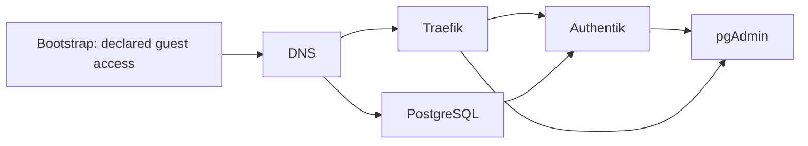

# HTTPS, sign-in and database administration

[Back to the application guide](README.md)

This stage adds three small guests after DNS and PostgreSQL are working:
**Traefik** provides HTTPS, **Authentik** provides sign-in, and **pgAdmin** gives
you a web interface for PostgreSQL. You review the private deployment settings
and merge them; GitHub then creates and configures the selected guests.

You do not need to create empty containers in Proxmox or paste settings into
individual Docker containers. The same OpenTofu and Ansible installer handles
each guest. Existing databases are restored separately; this stage does not
restore or replace PostgreSQL.



## What you prepare

Keep site settings in your **private deployment repository**:

- One `site.json` and `stack.json` for each guest: addresses, resources, pinned
  images and selected health checks.
- A coherent copy of Authentik's media/templates/certificates and its selected
  Redis state, plus a separate restore of its PostgreSQL database. Retain the
  original Authentik secret key; changing it can make restored credentials unusable.
- A consistent pgAdmin profile backup. Use SQLite's online backup facility;
  copying a live database and its journal separately is not a consistent backup.
- A private GitHub Environment with the existing Authentik key/database password,
  pgAdmin OAuth client secret and a Cloudflare DNS token restricted to the
  intended zone. Any required SMTP password is another Secret.
- NAS recovery copies and a reviewed, unused guest identity for each new guest.

Keep the same application versions for this migration. Upgrading them is a
separate change. If pgAdmin's saved profile is present, its pinned image can
start without inventing another local administrator password.

## How addresses become HTTPS routes

The selected **NX211 Proxmox provider** reads Traefik labels from guests' Proxmox
Notes. Private profiles declare only a route name, hostname and explicit backend
HTTP address. The installer turns those into Notes during guest creation.

For example, an identity guest might declare:

```json
"discovery_routes": [
  {"name": "identity", "host": "sso.example.net", "url": "http://10.77.30.20:9000"}
]
```

The backend must be a private IPv4 address on that guest. This avoids guessing
which of a guest's network interfaces should serve the application. The provider
is pinned to `v0.7.0`; the installer emits `key: value` Notes because that
version's parser can misread an equals-form URL containing a colon.
The catalog ZIP is also pinned by its SHA256 archive hash, independently
matched to tested commit `e35cce5af139328b8e424836a0b32638ed777016`. Traefik refuses
to start if the archive changes or the required plugin cannot load.

Shared HTTPS settings live in freshly generated Traefik configuration. No Docker
socket or old collection of routing files is copied across. Authentik and
pgAdmin use their own sign-in; they do not receive a second forward-auth layer.

The ingress `foundation` settings must also list the recursive DNS servers its
firewall allows, including port 53, for example
`"acme_dns_resolvers": ["198.18.40.2:53", "198.18.100.4:53"]`.
For certificate creation and renewal, Traefik checks the challenge TXT record at
every listed resolver. It avoids direct queries to external authoritative DNS
servers, which the restricted guest firewall blocks. These resolvers must be
able to retrieve public TXT records; ordinary certificate and Proxmox TLS
verification remain enabled. See the [Traefik DNS propagation settings](https://doc.traefik.io/traefik/v3.7/reference/install-configuration/tls/certificate-resolvers/acme/).

The provider has its own read-only Proxmox token. Bootstrap CD creates it for
only the declared node/guest scopes, verifies TLS using the host CA, saves the
credential privately on the runner and NAS, and admits only the proxy's address
to the host API. Review that new access in
[service discovery access](../bootstrap/SERVICE-DISCOVERY.md) before deployment.

## Where passwords go

The optional `foundation` stack settings contain **file paths**, not passwords.
CD takes values from GitHub Secrets and writes private runner inputs. Ansible
installs read-only files owned by the application user inside the new guest.
Authentik reads `file://` references; pgAdmin reads its generated `config_local.py`;
Traefik receives a private provider configuration and DNS-token file.

Compose files and Proxmox Notes contain no secret values. Keep logs, state,
captures and generated runtime files private too. GitHub masks known Secrets,
but that does not make arbitrary diagnostic output safe to publish.

## What happens on merge

The private foundation adapter plans once, checks that the plan creates only the
selected new guest and its two firewall resources, and deploys **that same saved
plan**. The reviewed merge authorizes this narrow creation policy. Updates,
imports, replacements and adoption of an existing guest are refused.

A completed repeat verifies the existing guest and unchanged inputs; it does
not reinstall, restore or restart the application. A failed or interrupted
rollout keeps its receipts and hold. A later job cannot silently retry it.

Use separate immutable source locks for the new foundation and bootstrap jobs.
Do not change the source pin or saved input files of already commissioned
DNS/database guests just to deploy these services.

The selected internal DNS records should point to the proxy before application
checks run. Router/firewall/WAN forwarding and browser sign-in are separate
acceptance checks; a passing synthetic test does not establish those live paths.

## What has been tested

Source tests cover configuration, private-file permissions, route generation,
plan admission and stopped/failed rollouts. A real pinned Traefik/provider Docker
fixture discovers synthetic LXC Notes over HTTPS, rejects an unrelated CA and
routes to explicit backend addresses. It does not create a real Proxmox guest or
prove a household login.

A native deployment still has to prove creation, nested Docker startup, real
certificate issuance, database connectivity and the new URLs. Complete those
checks on the selected host before describing the migration as successful.
