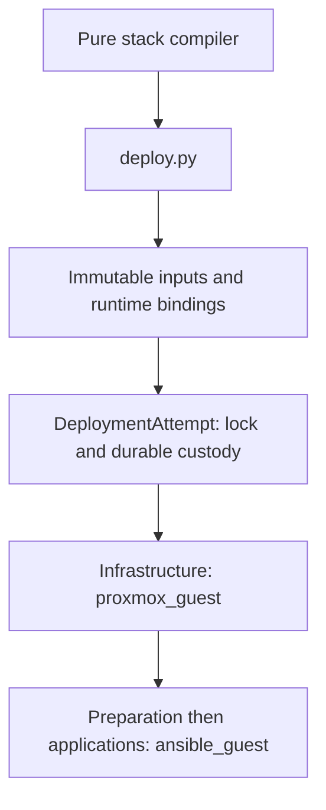

# Application deployment

`deploy.py` is the permanent deployment entrypoint. It accepts the current guest
packet and runs Infrastructure, Preparation, then the application's ordered phases.
There are no service-specific deployment controllers or historical packet adapters.
The stack composes eleven supported guests; the private site selects and enables them.

| Module | Responsibility |
| --- | --- |
| [guest_contract.py](guest_contract.py) | Pure guest, resource, capability and prerequisite validation |
| [deployment_inputs.py](deployment_inputs.py) | Immutable input materialization and external-file binding |
| [runtime_secrets.py](runtime_secrets.py) | Delivery of fixed existing runtime bindings |
| [secret_contract.py](secret_contract.py) | One definition of required secrets, sources and runtime filenames |
| [private_io.py](private_io.py) | Owned private files and durable writes |
| [deployment_state.py](deployment_state.py) | Per-guest locks, ordered attempts, holds and receipts |
| [plan_policy.py](plan_policy.py) | The saved-plan policy for explicit creation or reconciliation |
| [proxmox_guest.py](proxmox_guest.py) | TLS API, safe saved plans, creation identity and state recovery copies |
| [ansible_guest.py](ansible_guest.py) | Preparation/application invocation with exact SSH trust |
| [deploy.py](deploy.py) | The fixed deployment sequence and CLI |
| [zigbee2mqtt.py](zigbee2mqtt.py) | Preserved network/coordinator identity and active application verification |
| [dns_records.py](dns_records.py) | Owned Pi-hole records, exact readback and direct local DNS probes |
| [discovery.py](discovery.py) | Shared route validation, Proxmox Notes labels and ingress file configuration |

Infrastructure, shared Preparation and each application remain separate entities
inside one guest workflow. Preparation owns Linux and Docker/Compose once per LXC;
Docker is not repeated in each application. Deployment selects running guests.
Zigbee2MQTT uses the same sequence, with its one stable serial device declared in
the BPG container resource. There are no stopped, prepare/attached or first-start
deployment modes. Prepared data/configuration remain prerequisites, and ordinary
deployment never extracts captures or creates a new Zigbee network.

Before starting Zigbee, the application records the prepared network identity and
coordinator in a private receipt. Subsequent runs require that identity unchanged;
normal device database and counter updates are allowed. The container defaults to
`restart: always`, and its health check makes Compose wait for the frontend.
The physical USB device and Proxmox permissions still require native qualification.

A `DeploymentAttempt` owns one guest's existing state and one GitHub run. It is not
a scheduler or an arbitrary task graph. PVE and Ansible own their own execution;
application-specific validation/rendering stays with the application components.
The adapters recheck effective bindings before and after native work.

All Docker containers default to `restart: always` through
[the shared container policy](container_policy.py), including Bitwarden, PegaProx
and the standalone monitoring component. Guest profiles omit `restart` and inherit
this convention. An explicit `restart` override may select `always`, `unless-stopped`
or `no`; the current stack has no overrides. Native database services use systemd.
Readiness checks remain independent of Docker's restart policy; automatic restarts
do not replace prepared application state or deployment verification.

Plan admission has one owner. Both creation and reconciliation reject import,
move, replacement, deferred identity and drift; reconciliation also protects data
volumes and installed guest identity. There is no separate historical plan CLI.
Foundation injection, validation and rendering share the fixed secret contract.
Private readers/writers are shared by the renderers and command evidence logs;
unexpected ownership, permissions or symlinks hold rather than being normalized.

MariaDB package-account preparation uses its explicit current account mode and
recorded numeric identity. It never accepts an installer `new_target` flag.
Node-RED uses native Authentik OIDC. HTTP hostnames and middleware references belong
to the separate stack/site routes map. The HA mDNS helper requires `HOMELAB_HA_IPV4`.
It does not infer an address from the former `MACVLAN_PREFIX` input. Separately
prepared runtime files must already match these current inputs before adoption.

The [blueprint catalogue](../../blueprints/catalogue.json) owns phase order,
capabilities and mandatory preserved paths. The compiler adds those prerequisites;
the runtime validates them; Ansible checks them before package/service changes.
Stacks may add prerequisites, but cannot remove or change a mandatory path's type.

The compiler resolves the complete composition once and rejects duplicate VMIDs
before admitting any guest packet. Every enabled guest must satisfy its readiness
inputs. A workflow then selects its packet and phase from that validated model.
The current compiler API is `compile_stack`; there is no separate guest-only
admission path.

The guest contract presents named images consistently to compilation and runtime
preparation. Ansible receives only the derived image archive inputs, so the shared
task does not depend on an application's source shape. Rendered data binds must
all have declared prepared paths. Startup files such as the HA mDNS helper and
original Node-RED settings are explicit file prerequisites as well. Preparation
refreshes repository indexes before installing the exact approved packages.

See [the deployment contract](../../docs/stack-contract.md) for custody and adoption.
Run source tests with `python3 -m unittest discover -s proxmox/applications/tests`.
The Linux/container fixtures in `tests/check.sh` are for disposable source CI only;
this redesign does not claim they ran on native PVE or in hosted Actions.

Other retained components have current consumers: the Compose renderer and app
health probes serve deployment; routing and Node-RED helpers are maintained runtime
configuration used by the prepared applications; the monitoring renderer, schema,
templates and acceptance probe support the existing clean monitoring/active-agent
fixtures. The unused agent deployment task has been retired. Host/ISO bootstrap remains a separate
framework subsystem. No old deployment template is needed to use these components.

Configuration conversion, SQL/data restore, initial account creation and writable
cutover are explicit operator prerequisites. They are not implemented as alternate
application deployment paths. Historical procedures are recoverable from Git; the
current source tree does not retain their orchestration scripts or compatibility
branches. Existing state/hold names remain safety records and are never converted
or cleared by this cleanup.

The [monitoring stack example](monitoring/stack.example.json) and matching
[version contract](monitoring/versions.json) describe the reusable monitoring
component. Its secret files must be supplied externally. It has no separate
deployment controller and is not enabled as a guest by this stack.

Native PostgreSQL, MariaDB and InfluxDB use the shared repository/package/account
preparation tasks and parameterized database reconciliation. Retained numeric
UID/GID values must match before vendor packages run. The explicit MariaDB
package-account mode records the vendor-created identity rather than renumbering
it. SQL import, database contents and writer handover are separate prerequisites;
ordinary deployment never restores or imports them. Database backend NICs and
listener substitutions come from the reviewed stack/site definitions.
