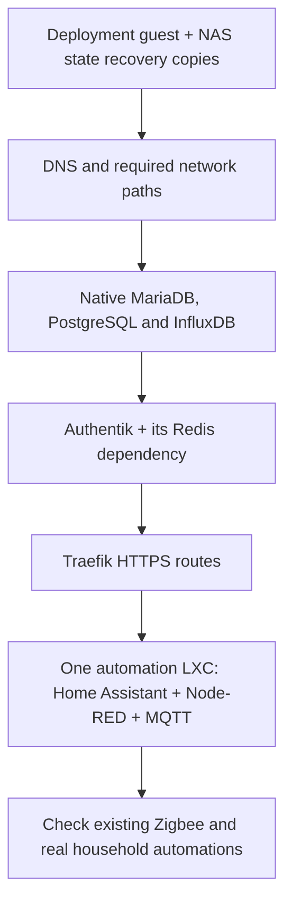

# After bootstrap: bring home automation across one guest at a time

[Proxmox guide](../README.md) · [Bootstrap](../bootstrap/README.md) ·
[PegaProx decision](pegaprox.md) · [Technical reference](OPERATIONS.md)

The deployment guest receives GitHub jobs. These scripts are the next step:
**OpenTofu creates one application guest; Ansible installs its applications and
restores its saved configuration.**

**Current status:** application source and synthetic tests are available. This
application path has not yet created or restored a guest on the rehearsal
Proxmox system. Passing Docker tests does not mean the house has migrated.
The earlier physical ISO/bootstrap result remains separate.

## What are we bringing across?

| Order | What it does | What must be proved before moving on |
| --- | --- | --- |
| 0 | Keep the runner's state recoverable on the NAS | Recovery copy written/read back; one active state owner |
| 1 | DNS, using Pi-hole and Unbound | Lookups work from the next guest; router still provides DHCP |
| 2 | Required native databases | Matching versions, restored users/grants/data and a real client query |
| 3 | Authentik, including Redis for the installed version | Login and the restored Node-RED provider/outpost work |
| 4 | Traefik HTTPS access | Valid certificate, HA's own login, Node-RED's Authentik login |
| 5 | The shared automation guest | HA, Node-RED and MQTT work together with restored settings |
| 6 | The working house | Existing radios, devices, automations and household access work |

This is a dependency list, not one job that creates everything. PegaProx, PBS
and optional recovery projects are not HA prerequisites. Existing radio
services and physical hosts stay in place.

## What you need before deployment

- A working [bootstrap](../bootstrap/README.md) and private GitHub deployment repository.
- An unused guest ID/address and resource budget, with its VLAN carried by the
  host and switches. These scripts do not configure your router or switches.
- API access for that guest/storage/network. **The bootstrap token covers only
  the deployment guest; it cannot create application guests.**
- The runner's NAS recovery directory, deployment SSH key, trusted Proxmox CA
  and verified guest SSH host key. Secrets stay in private runner files.
- A coherent NAS capture of this guest's configuration/data, required database
  backups, preserved custom images and independently available keys.
- NAS protection for new application/database writes, commissioned before the
  live start. State recovery copies alone do not back up application data.

Use database-native backups, not copies of files from running databases.
Preserve numeric file owners, permissions, ACLs and extended attributes.

## How a deployment works

First, copy the [private-repository workflow templates](templates/README.md)
into your own private deployment repository and supply its private inputs.

Use **Application guest deployment** in the private repository's Actions tab.
Select one guest and one step:

1. **Plan:** preview one guest and its firewall. Review the result and retain its
   plan SHA256, the fingerprint of the exact saved plan.
2. **Apply:** supply that fingerprint to create/update only the reviewed guest.
   Replacement and deletion are refused.
3. **Stage:** install packages, restore files into the new guest and validate
   configuration. Restored application/database services remain stopped.
4. **Start:** at the chosen migration window, after confirming the old writers
   are retired for this service. HA can control real devices: choose this step
   deliberately.
5. **Verify:** run the service checks, then check real devices and automations
   with the people using the house.

Active state stays outside the checkout, with NAS copies before and after each
step. A failed change leaves a **HOLD** and private logs for review; rerunning a
job does not automatically retry or clean up that target.

## Where do settings live?

| Public `homelab` | Private deployment repository |
| --- | --- |
| Guest/app scripts, synthetic examples, tests and guides | Exact public-source revision, site-specific guest settings and deployment workflow |
| No household addresses, passwords or personal backups | Addresses/VLAN selections can be private Git; tokens, private keys, dumps and restored app settings stay outside Git |

The [example inputs](examples/site.example.json) have invented addresses and
deliberately unusable package/image selections. Replace them privately using
the [technical reference](OPERATIONS.md); do not point unchanged examples at a server.

## What is still outstanding?

Native package installation, database restores, Docker inside the selected LXC,
real VLAN discovery, application logins and household acceptance require the
selected rehearsal and then the actual target. Keep the old working system
available until those checks succeed.
