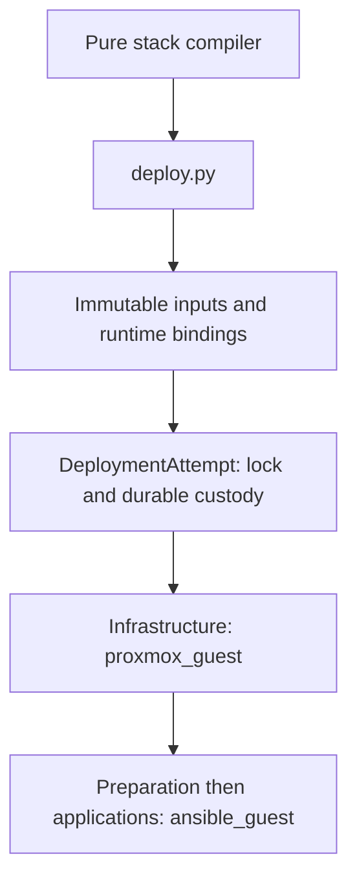

# Application deployment

`deploy.py` is the permanent deployment entrypoint. It accepts the current guest
packet and runs Infrastructure, Preparation, then the application's ordered phases.
When the root Zabbix feature is selected, one final Zabbix agent step configures
that guest's agent after its applications. The final ordinary receipt is written
only after that step passes. Application steps retain their local database
statistics and Zabbix database preparation responsibilities.
There are no service-specific deployment controllers or historical packet adapters.
The stack selects supported guests from the catalogue; the private site binds
their genuine prepared inputs and enables them.

| Module | Responsibility |
| --- | --- |
| [guest_contract.py](guest_contract.py) | Pure guest, resource, capability and prerequisite validation |
| [deployment_inputs.py](deployment_inputs.py) | Immutable input materialization and external-file binding |
| [runtime_secrets.py](runtime_secrets.py) | Delivery of fixed existing runtime bindings |
| [secret_contract.py](secret_contract.py) | One definition of required secrets, sources and runtime filenames |
| [private_io.py](private_io.py) | Owned private files and durable writes |
| [deployment_state.py](deployment_state.py) | Per-guest locks, ordered attempts, holds and receipts |
| [plan_policy.py](plan_policy.py) | The saved-plan policy for explicit creation or reconciliation |
| [proxmox_guest.py](proxmox_guest.py) | TLS API, safe saved plans, creation identity and state recovery copies |
| [ansible_guest.py](ansible_guest.py) | Preparation/application invocation with exact SSH trust |
| [deploy.py](deploy.py) | The fixed deployment sequence and CLI |
| [zigbee2mqtt.py](zigbee2mqtt.py) | Preserved network/coordinator identity and active application verification |
| [dns_records.py](dns_records.py) | Owned Pi-hole records, exact readback and direct local DNS probes |
| [discovery.py](discovery.py) | Shared route validation, Proxmox Notes labels and ingress file configuration |

Infrastructure, shared Preparation and each application remain separate entities
inside one guest workflow. Preparation owns Linux and Docker/Compose once per LXC;
Docker is not repeated in each application. Deployment selects running guests.
Zigbee2MQTT uses the same sequence, with its one stable serial device declared in
the BPG container resource. There are no stopped, prepare/attached or first-start
deployment modes. Prepared data/configuration remain prerequisites, and ordinary
deployment never extracts captures or creates a new Zigbee network.
Its guest display name is Radios; the Zigbee service, data and monitoring
identities remain unchanged.

Music Assistant runs the upstream `ghcr.io/music-assistant/server:latest` image by
explicit operator policy. This and Bitwarden are the two closed floating-image
exceptions. Ordinary Music deployments pull that tag and may upgrade the upstream
version. The dedicated Music guest requires its separately prepared original
settings, library, accounts and playlists. Startup verifies the retained identity,
providers and chosen UI/player listeners without rewriting them. A successful
service health check does not claim actual playback acceptance.

The dedicated MQTT guest retains the pinned Mosquitto image and existing broker
configuration, accounts and persistence. Its private `mqtt.credential_file` binds
one retained account for authenticated-CONNECT and anonymous-refusal checks;
unrelated Home Assistant credentials are not copied. Old Automation profiles may
still select their shared broker. A new profile omitting it refuses while its
retained managed broker container exists, so source adoption cannot silently
leave a second writer or delete the old broker/data.

Optional `mqtt_explorer` adds a separately named application phase in that same
guest. Its pinned browser service is unpublished on a private Docker bridge;
only a file-provider Traefik sidecar publishes the configured backend address and
checks every application/Socket.IO request with the declared Authentik outpost.
Local startup and health do not require the identity provider. The selected
browser hostname must already be registered with the outpost. No AI keys,
automatic broker connection or real-topic test publication is configured.

An optional `mqtt_explorer.broker_connection` declares `name`, `hostname`, `port`,
`username`, `credential_id`, `credential_file`, `password_file`, and the closed
`access: read-write-all` choice. Its named `service_connections` binding must
resolve to this guest's existing MQTT publication on port 1883. CD creates one
independent credential and appends only its absent account to the selected
parent-mounted password file, preserving old bytes, ownership, modes and xattrs.
Compilation derives `broker_address` from that selected publication; it is not
a raw profile field. Only Explorer receives the saved hostname's runtime alias
to that address. The GUI listener address, public DNS, saved connection and
credential records remain independent. Health verifies the exact alias.
Unexpected ACL/include/per-listener authentication refuses this finite path.
An atomic replacement and HUP reload preserve the existing broker container;
GUI-only reconciliation targets only the two GUI services. Interrupted account
or profile work retains a hold. The owned native saved connection is plaintext
inside the protected UID-1001 mode-0700 workspace, with mode-0600 settings; other
settings and connections are preserved. Authentik-admitted GUI users share that
account's read/write topic access. Neither the probe nor application credentials
are reused or rotated.

The `managed-<credential_id>` connection is CD-owned. Editing that entry, or an
application rewrite that changes its declared fields, is drift and makes later
CD refuse while preserving the settings and proof. Create a separate connection
for personal settings; CD never automatically adopts or overwrites a changed
managed entry.

Before starting Zigbee, the application records the prepared network identity and
coordinator in a private receipt. Subsequent runs require that identity unchanged;
normal device database and counter updates are allowed. The container defaults to
`restart: always`, and its health check makes Compose wait for the frontend.
The physical USB device and Proxmox permissions still require native qualification.

A `DeploymentAttempt` owns one guest's existing state and one GitHub run. It is not
a scheduler or an arbitrary task graph. PVE and Ansible own their own execution;
application-specific validation/rendering stays with the application components.
The adapters recheck effective bindings before and after native work.

All Docker containers default to `restart: always` through
[the shared container policy](container_policy.py), including Bitwarden, PegaProx
and the standalone monitoring component. Guest profiles omit `restart` and inherit
this convention. An explicit `restart` override may select `always`, `unless-stopped`
or `no`; the current stack has no overrides. Native database services use systemd.
Readiness checks remain independent of Docker's restart policy; automatic restarts
do not replace prepared application state or deployment verification.

Plan admission has one owner. Both creation and reconciliation reject import,
move, replacement, deferred identity and drift; reconciliation also protects data
volumes and installed guest identity. There is no separate historical plan CLI.
Foundation injection, validation and rendering share the fixed secret contract.
Private readers/writers are shared by the renderers and command evidence logs;
unexpected ownership, permissions or symlinks hold rather than being normalized.

MariaDB package-account preparation uses its explicit current account mode and
recorded numeric identity. It never accepts an installer `new_target` flag.
Node-RED uses native Authentik OIDC. HTTP hostnames and middleware references belong
to the separate stack/site routes map. The HA mDNS helper requires `HOMELAB_HA_IPV4`.
It does not infer an address from the former `MACVLAN_PREFIX` input. Separately
prepared runtime files must already match these current inputs before adoption.

The [blueprint catalogue](../../blueprints/catalogue.json) owns phase order,
capabilities and mandatory preserved paths. The compiler adds those prerequisites;
the runtime validates them; Ansible checks them before package/service changes.
Stacks may add prerequisites, but cannot remove or change a mandatory path's type.

The compiler resolves the complete composition once and rejects duplicate VMIDs
before admitting any guest packet. Every enabled guest must satisfy its readiness
inputs. A workflow then selects its packet and phase from that validated model.
The current compiler API is `compile_stack`; there is no separate guest-only
admission path.

The guest contract presents named images consistently to compilation and runtime
preparation. Ansible receives only the derived image archive inputs, so the shared
task does not depend on an application's source shape. Rendered data binds must
all have declared prepared paths. Startup files such as the HA mDNS helper and
original Node-RED settings are explicit file prerequisites as well. Preparation
refreshes repository indexes before installing the exact approved packages.

See [the deployment contract](../../docs/stack-contract.md) for custody and adoption.
Run source tests with `python3 -m unittest discover -s proxmox/applications/tests`.
The Linux/container fixtures in `tests/check.sh` are for disposable source CI only;
this redesign does not claim they ran on native PVE or in hosted Actions.

Other retained components have current consumers: the Compose renderer and app
health probes serve deployment; routing and Node-RED helpers are maintained runtime
configuration used by the prepared applications; the monitoring renderer, schema,
templates and acceptance probe support the existing clean monitoring/active-agent
fixtures. The unused agent deployment task has been retired. Host/ISO bootstrap remains a separate
framework subsystem. No old deployment template is needed to use these components.

Configuration conversion, SQL/data restore, initial account creation and writable
cutover are explicit operator prerequisites. They are not implemented as alternate
application deployment paths. Historical procedures are recoverable from Git; the
current source tree does not retain their orchestration scripts or compatibility
branches. Existing state/hold names remain safety records and are never converted
or cleared by this cleanup.

The [monitoring stack example](monitoring/stack.example.json) and matching
[version contract](monitoring/versions.json) describe the reusable monitoring
component. Its secret files must be supplied externally. It has no separate
deployment controller and is not enabled as a guest by this stack.

Native PostgreSQL, MariaDB and InfluxDB use the shared repository/package/account
preparation tasks and parameterized database reconciliation. Retained numeric
UID/GID values must match before vendor packages run. The explicit MariaDB
package-account mode records the vendor-created identity rather than renumbering
it. SQL import, database contents and writer handover are separate prerequisites;
ordinary deployment never restores or imports them. Database backend NICs and
listener substitutions come from the reviewed stack/site definitions.

Home Assistant readiness requires its web page and initial WebSocket
`auth_required` challenge, then closes without sending credentials. It does not
request an unauthenticated REST response: repeated HTTP 401 responses can trigger
the retained application's IP-ban policy. Authentication and banning stay enabled.

### Reviewed failure after infrastructure succeeds

A failed application step does not make its infrastructure update a completed
application deployment. For a separately reviewed own failure, a private guest
configuration may select `reviewed_ordinary_failures`: exact operation and phase,
SHA256 pins for the preserved failed hold, completed infrastructure and failed
log, plus the prior ordinary receipt and resulting backend digest. The operator
must preserve that exact active hold inside its failed operation first. CD never
releases it. Changed, foreign, unselected, pending or already completed attempts
still refuse. A selected checkpoint admits only its verified backend identity;
application steps execute in a new workflow run and must earn a real new final
receipt. Original commissioning groups and failed records remain intact.

The same exact failed-operation proofs apply to an explicitly selected standalone
initial ordinary profile. Its immutable first anchor stays unchanged; this does
not extend the exception for pre-anchor incomplete history or adopt an unknown
failed operation. Subsequent deployment still runs every phase and must produce
its own successful receipt.

PostgreSQL monitoring commands use `runuser -u postgres --` from the existing root
connection. They do not assume that minimal Debian guests have `sudo` installed.

The explicit `db-tools` variant `cloudbeaver` selects CloudBeaver Community and a
pinned OIDC gateway in one existing guest/application phase. The legacy omitted
variant still means pgAdmin. The variant changes neither the database-tools guest
identity nor its completed-custody membership. Database connection metadata binds
to named published PostgreSQL/MariaDB services; it contains no shared database
usernames, passwords or client keys. PostgreSQL SSL mode is explicit. Each signed-in
user supplies their own database credentials.

Optional `app.database_administrators` on PostgreSQL/MariaDB declares a map of
owned accounts with `username`, `source_guest`, `credential_id`, `credential_file`,
`access: server-administration`, and `transport: tls`. Optional
`cloudbeaver.managed_connections` declares separate new IDs containing `name`,
`driver`, `database`, and `account_id`; each must have a named database-service
binding. Compilation derives the actual database/client identities and addresses,
requires independent credential IDs and a shared controller credential store,
and refuses metadata-ID overwrites or a mismatched account owner. Ordinary CD
creates a credential once, with no existing-password reuse or rotation.
The database must already be commissioned, running and TLS-enabled. The read-only
account preflight checks collisions, custody and TLS before ordinary configuration
or service reconciliation; a stopped or TLS-disabled preimage refuses. This
optional capability does not commission or recover a database server.

These are full server administrators: PostgreSQL SUPERUSER includes server-file
and program powers; MariaDB receives `ALL ON *.* WITH GRANT OPTION`. Native
authentication restricts each account to the exact selected CloudBeaver source
address and requires TLS. PostgreSQL uses `sslmode=require`,
`channelBinding=require` and the positive `requireAuth=scram-sha-256` setting.
Readiness accepts the packaged PgJDBC 42.7 family from 42.7.13 onward, checks its
actual loaded version and refuses conflicting selected driver overrides/cache.
SCRAM channel binding authenticates the TLS endpoint using the password exchange;
this does not claim CA-chain or hostname validation. MariaDB uses `sslMode=verify-full`
with PARSEC's supported zero-configuration certificate fingerprint authentication.
No backend certificate lifecycle is introduced. A bounded JDBC read verifies the
account, source, TLS and privileges without creating application data.
Before creating a PostgreSQL LOGIN role, CD validates the whole HBA file, reloads
the running server under the account hold, observes the postmaster reload and
rechecks the selected rules. Updates also reload without restarting the service;
read-only preflight never reloads it.
Every user admitted by the configured OIDC application receives the managed
connections through CloudBeaver's existing `user` team. These shared administrators
therefore require an explicitly restricted upstream sign-in policy; they do not
provide a separate per-user database privilege boundary.
The new MariaDB account uses the bundled PARSEC plugin, reusing an exact active
vendor plugin or installing only `auth_parsec` under the account's existing hold.
Existing users and the default authentication plugin remain unchanged. PARSEC
uses a fresh 18-byte salt, the selected server's supported P3/8192-round
PBKDF2-SHA512 protocol and stock OpenSSL Ed25519 with the generated 256-bit machine
credential. The private key seed stays on stdin; SQL receives only its public
verifier. There is no native-password/SHA1 fallback. This requires MariaDB 11.6+
with the bundled plugin, an Ed25519-capable OpenSSL and a PARSEC-capable client.
Separate owner-bound custody fingerprints use PBKDF2-HMAC-SHA256/600000 rounds;
their work factor is distinct from the vendor authentication protocol.

Managed MariaDB connections also require `cloudbeaver.mariadb_jdbc` containing
`version`, `sha256` and `image_filename`. CD downloads the official Maven artifact
over verified HTTPS with the declared checksum, installs it mode 0400 and mounts
that single file read-only. The selected image's driver-directory contract must
be qualified: an explicit older compatibility filename can contain the declared
fixed bytes; its name does not assert their version. The current fixed selection
is 3.5.11. Local readiness requires one MariaDB jar, its exact hash and manifest
version; the JDBC read also checks the loaded version and that metadata URLs omit
the password. Omission preserves metadata-only and PostgreSQL-only behavior.
In this mode the existing Java health check also refuses a selected MariaDB
driver override, conflicting MariaDB cache bytes, persisted driver-home settings
or runtime flags outside the generated configuration. It reads only the vendor's
default cache/configuration locations, with size, entry and depth limits and no
symlink traversal. Unrelated records are preserved; caches and overrides are
never removed or rewritten to make a deployment pass.

Community consumes an owned native datasource file, plaintext at rest, mode 0600
under its UID-8978 mode-0700 workspace. Only this optional mode enables native
administrator credential saving. The runtime owns only its declared new IDs and
permissions; existing metadata, custom user connections, resource functionality
and unrelated grants remain application-owned. Foreign account/file collisions,
changed custody or incomplete operations refuse rather than reset or adopt.
Every Authentik-admitted user can use these shared dedicated administrators;
ordinary connection metadata does not expose their passwords. This capability
does not change identity-provider policy or grant CloudBeaver application-admin
roles to browser users.

Only the gateway publishes a host port. CloudBeaver uses an unpublished Docker
bridge that permits database egress; host firewall state is not the authentication
boundary. The gateway verifies OIDC signatures, issuer, audience, nonce and PKCE,
then removes incoming identity/role/profile headers and injects a namespaced
verified identity plus the fixed `user` team. The recovery administrator name
cannot use that namespace. Cookies are HTTPS-only, HttpOnly and host-scoped;
CloudBeaver handles the trusted forwarded HTTPS scheme. The existing retained
OAuth secret derives independent cookie/recovery material into private files,
never Compose environment values or Git.

The OIDC provider must assert `email_verified: true` only for an actually verified
email address. Missing or false verification is refused by the gateway's secure
default. Complete address verification through the identity provider; the
configuration does not enable the insecure unverified-email mode.

CloudBeaver's optional `foundation.oidc_endpoints` object declares
`authorization_url`, `token_url`, `userinfo_url`, `jwks_url` and a nonempty unique
`signing_algorithms` list of supported asymmetric algorithms. These URLs require
HTTPS without credentials, queries or fragments. This mode supplies the endpoint
metadata directly, so the gateway can start while the identity provider is
unavailable. Omission retains startup discovery. Both modes require the declared
client ID and protected client secret, and retain issuer, audience, signature,
nonce, PKCE and verified-email checks. The remote JWKS remains authoritative;
new sign-in requires the identity provider and its registered callback. Service
readiness and an HTTPS sign-in redirect do not prove successful authentication.
Callback maintenance remains in the identity guest's deployment.

Preparation owns only the new `/srv/homelab/data/cloudbeaver` workspace. First
startup configures its own recovery account before the gateway becomes healthy;
subsequent deployments verify ownership and never reset an unknown account. The
pinned image’s existing JDK performs a bounded loopback check requiring closed
setup, anonymous access disabled, the selected providers and forced HTTPS before
the gateway starts. The
finite connection-template permissions are seeded once, then verified while
preserving additional application-owned connections/grants. A changed managed
permission refuses rather than being overwritten. Health verifies the managed
template endpoints and explicit SSL mode; changing source metadata for an already
initialized workspace currently refuses stale values. A later managed endpoint
update requires an explicit CD capability, not an outside-CD repair. The application phase retires
only an exact managed pgAdmin container after verifying its pinned image, labels
and data bind; it preserves the pgAdmin directory and retirement evidence. There
is no orphan pruning, data import or shared-account migration.

Identity foundation `allowed_callback_additions` is a typed, optional add-only
maintenance contract. Exact retained provider/application/policy hashes and the
ordered old strict redirects must match. One serializable transaction appends only
the declared HTTPS `/oauth2/callback` URLs; repeat runs verify them. It does not
change client secrets, identity flows, application access policy or other providers.

Ingress foundation `discovery_scope` optionally verifies an existing finite
mirrored bootstrap-owned discovery scope before the existing Traefik phase. It
compares the configured runtime credential to retained custody, verifies effective
read privileges and reads every declared guest configuration over verified TLS.
It never creates a token, grants permissions or repairs a missing scope. Missing
access fails with the existing privileged bootstrap CD dependency. HTTPS service
checks remain separate proof of the actual endpoint and certificate.

Ingress foundation optionally accepts `acme_dns_propagation_timeout_seconds`, an
integer from 120 through 2100. It renders only the Cloudflare provider's
`CLOUDFLARE_PROPAGATION_TIMEOUT` in decimal seconds; omission leaves the existing
environment unchanged. DNS propagation checks, resolver selection, TLS validation
and file-based credentials remain enforced. This bounds the wait for the expected
DNS record; it does not guarantee certificate issuance or permit arbitrary environment settings.
