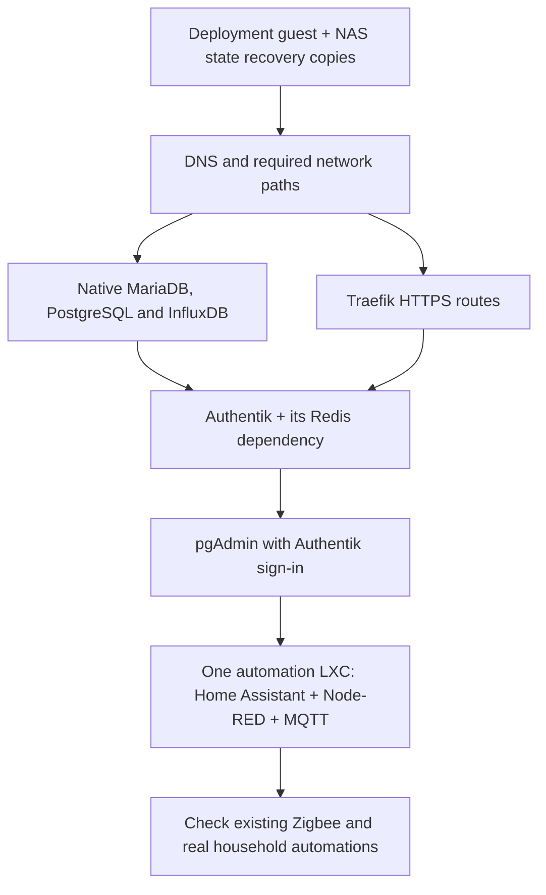

# After bootstrap: bring home automation across one guest at a time

[Proxmox guide](../README.md) · [Bootstrap](../bootstrap/README.md) ·
[Databases](DATABASES.md) · [HTTPS and sign-in](FOUNDATION.md) · [pgAdmin](PGADMIN.md) · [PegaProx decision](pegaprox.md) · [Technical reference](OPERATIONS.md)

The deployment guest receives GitHub jobs. These scripts are the next step:
**OpenTofu creates one application guest; Ansible installs its applications and
restores its saved configuration. Database guests are the exception: CD prepares
an empty database server; existing databases are restored separately before their
applications start.**

**Current status:** DNS has been created, restored, started and checked on a
physical Proxmox host through private GitHub CD. All three empty database servers
have also passed native installation, systemd startup and service-specific checks
through CD, using the matching versions listed in the [database guide](DATABASES.md).
Their first creation stopped on a startup compatibility warning; the existing
empty guests were corrected and finished through an explicitly reviewed
continuation. A fresh, uninterrupted Deploy from that corrected baseline has
not been retested. Database contents, later applications and household acceptance
remain separate work. The [foundation stage](FOUNDATION.md) has also reached native
Traefik and Authentik service checks and pgAdmin's local login page. Routed HTTPS
and browser sign-in are still outstanding; installed services alone do not prove
that this stage works.

## What are we bringing across?

| Order | What it does | What must be proved before moving on |
| --- | --- | --- |
| 0 | Keep the runner's state recoverable on the NAS | Recovery copy written/read back; one active state owner |
| 1 | DNS, using Pi-hole and Unbound | Lookups work from the next guest; router still provides DHCP |
| 2 | Required native databases | Matching versions, restored users/grants/data and a real client query |
| 3 | Traefik HTTPS access | Verified Proxmox discovery and valid certificates for selected routes |
| 4 | Authentik with Redis, then pgAdmin | Restored identity, native OAuth login and saved pgAdmin profile; Node-RED outpost follows with automation |
| 5 | The shared automation guest | HA, Node-RED and MQTT work together with restored settings |
| 6 | The working house | Existing radios, devices, automations and household access work |

The private Actions graph can chain these jobs after one reviewed merge. Each job
still owns one guest. See the [foundation guide](FOUNDATION.md) for the next three
services and its bounded first-creation policy. PegaProx, PBS
and optional recovery projects are not HA prerequisites. Existing radio
services and physical hosts stay in place.

## What you need before deployment

- A working [bootstrap](../bootstrap/README.md) and private GitHub deployment repository.
- An unused guest ID/address and resource budget, with its VLAN carried by the
  host and switches. These scripts do not configure your router or switches.
- API access for that guest/storage/network, declared through
  [bootstrap step 8](../bootstrap/README.md#8-prepare-the-runner-to-deploy-your-applications).
- The runner's NAS recovery directory, deployment SSH key and trusted Proxmox CA.
  Deploy verifies the new guest's SSH identity from its Proxmox creation log;
  no Proxmox root SSH private key goes onto the runner. Secrets stay private.
- For application guests, a coherent NAS capture of their configuration/data,
  preserved custom images and independently available keys. Database-server CD
  needs its private server configuration, packages and health probes, without a
  backup. Existing database restores are a separate migration step.
- NAS protection for new application/database writes, commissioned before the
  live start. State recovery copies alone do not back up application data.

Use `nesting: true` and `keyctl: false` for the tested Debian 13/systemd base,
while keeping the guest unprivileged. The tested database guests use fixed
management IPv4 and a separate fixed backend interface. An initial DHCP setup
waited for DHCPv6 and delayed the second interface; fixed management IPv4 avoided
that issue. The maintainer explicitly approved this profile for the three
empty database guests on 26 October 2026. Review and approve the feature, address
and allowed-traffic scope for your own host before applying it.

Static IPv4 addresses and reservation-backed DHCP are supported. For DHCP use
`"dhcp"` for both the selected interface's `ipv4` and the application's
`address`, and omit that interface's gateway. The deployment job obtains the
lease from the verified Proxmox API by the selected MAC address before Ansible.
The new SSH key must match the fingerprint recorded by Proxmox during this
reviewed creation. A network scan alone is never accepted.

Use database-native backups, not copies of files from running databases.
Preserve numeric file owners, permissions, ACLs and extended attributes.

## How a deployment works

New guests wait for their managed IPv4 networks before starting Docker or native
database services. The same shared startup gate protects a newly installed
deployment runner. This checks local network readiness, without requiring the
internet to answer. If readiness times out, the dependent service stays stopped
instead of starting with only some of its addresses. Existing guests need an
explicitly reviewed update; changing source does not silently restart them.
For ingress guests, the routing helper must wait for that gate too, before Docker.
An existing routing helper can receive this dependency through CD without
restarting it or Docker; its original unit and network-gate hashes are checked first.

First, copy the [private-repository workflow templates](templates/README.md)
into your own private deployment repository and supply its private inputs.

Use **Application guest deployment** in the private repository's Actions tab.
Select one guest:

1. **Plan:** preview one guest and its firewall. Review the result and retain its
   plan SHA256, the fingerprint of the exact saved plan.
2. **Deploy:** supply that fingerprint. One run creates the guest, verifies its
   identity, installs/configures it, starts the service and checks it. For an
   application guest, this also verifies and restores its saved data during the
   chosen migration window. For a database guest, it prepares an empty server
   and leaves the data restore to the separate migration step. It does
   not need another button press between these phases. Replacement and deletion
   remain refused.
3. Check the result, then check real devices and automations with the people
   using the house. **Verify** can run the service checks again without a restart.

Deploy starts the selected service. For application guests, confirm their old
writers are retired in the private inputs before choosing it. An empty database
server can be prepared while the original database remains in use; do not point
applications at it until the manual restore is complete. HA can control real devices: this is a
deliberate migration action, not a preview. Missing or mismatched application captures stop
the run before guest creation. Database CD never imports a backup.

The separate **apply**, **stage** and **start** steps remain available for
controlled qualification and reviewed recovery. They are not required during a
normal new-guest Deploy run. Existing or partly applied installations are held
for inspection rather than automatically reinstalled.

Active state stays outside the checkout, with NAS copies before and after each
phase. A failed change or interrupted Deploy leaves a **HOLD** and private logs
for review; rerunning a job does not automatically retry or clean up that target.

If an installed Traefik guest needs a certificate-DNS correction, use the reviewed
CD maintenance path. Its private packet names the old and new resolvers and binds
the existing guest, configuration and state. OpenTofu previews only the matching
DNS firewall additions; Ansible changes only that resolver list and recreates the
Traefik container once. It keeps the image, tokens, certificates and other settings.
Guest networking and Docker itself are not restarted. The existing health check
allows normal startup time before checking the running container. A failed attempt
stays held. If the change applied but its startup check failed, a separately
reviewed confirmation can check that same running container without applying the
firewall change or recreating it again. It preserves the failed logs and settings;
only a successful check archives its matching hold. The next CD step must still
show a no-change plan. A failed confirmation cannot retry on the next push.
An interrupted confirmation also stays held for separate review, even if the
guest check succeeded before CD lost control; a later push does not reconstruct
missing completion records automatically.
The standard continuation hold stays active until both local and NAS completion
records are saved, so other deployment entry points also stop if that final save
fails.
After the dependency is fixed, a separately approved verification continuation can
check the existing pgAdmin guest without reinstalling it or restoring its data.

## Where do settings live?

| Public `homelab` | Private deployment repository |
| --- | --- |
| Guest/app scripts, synthetic examples, tests and guides | Exact public-source revision, site-specific guest settings and deployment workflow |
| No household addresses, passwords or personal backups | Addresses/VLAN selections can be private Git; tokens, private keys, dumps and restored app settings stay outside Git |

The [example inputs](examples/site.example.json) have invented addresses and
deliberately unusable package/image selections. Replace them privately using
the [technical reference](OPERATIONS.md); do not point unchanged examples at a server.

## Scrypted preparation

[Scrypted has a separate preparation guide](SCRYPTED.md). Its decoder/GPU and
recording-source decisions remain held. The local review helper emits no
runnable stack; the application installer refuses Scrypted deployment.

## What is still outstanding?

The three empty database servers have passed native installation and startup.
Their household database restores and real client connections remain untested.
Later application guests still need their own Docker/configuration, network,
login and household checks on the selected target. Keep the old working system
available until those checks succeed.
