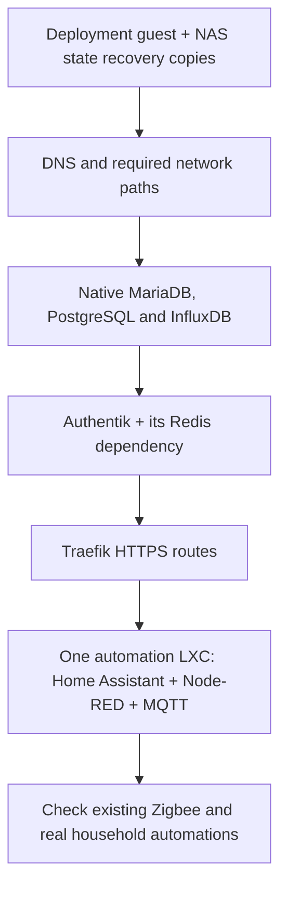

# After bootstrap: bring home automation across one guest at a time

[Proxmox guide](../README.md) · [Bootstrap](../bootstrap/README.md) ·
[Databases](DATABASES.md) · [PegaProx decision](pegaprox.md) · [Technical reference](OPERATIONS.md)

The deployment guest receives GitHub jobs. These scripts are the next step:
**OpenTofu creates one application guest; Ansible installs its applications and
restores its saved configuration. Database guests are the exception: CD prepares
an empty database server; existing databases are restored separately before their
applications start.**

**Current status:** DNS has been created, restored, started and checked on a
physical Proxmox host through private GitHub CD, using its existing configuration
and data. That deployment used separate workflow steps. The new combined
**Deploy** mode still needs its first complete native deployment acceptance;
source tests do not prove that every service or the house has migrated.

## What are we bringing across?

| Order | What it does | What must be proved before moving on |
| --- | --- | --- |
| 0 | Keep the runner's state recoverable on the NAS | Recovery copy written/read back; one active state owner |
| 1 | DNS, using Pi-hole and Unbound | Lookups work from the next guest; router still provides DHCP |
| 2 | Required native databases | Matching versions, restored users/grants/data and a real client query |
| 3 | Authentik, including Redis for the installed version | Login and the restored Node-RED provider/outpost work |
| 4 | Traefik HTTPS access | Valid certificate, HA's own login, Node-RED's Authentik login |
| 5 | The shared automation guest | HA, Node-RED and MQTT work together with restored settings |
| 6 | The working house | Existing radios, devices, automations and household access work |

This is a dependency list, not one job that creates everything. PegaProx, PBS
and optional recovery projects are not HA prerequisites. Existing radio
services and physical hosts stay in place.

## What you need before deployment

- A working [bootstrap](../bootstrap/README.md) and private GitHub deployment repository.
- An unused guest ID/address and resource budget, with its VLAN carried by the
  host and switches. These scripts do not configure your router or switches.
- API access for that guest/storage/network, declared through
  [bootstrap step 8](../bootstrap/README.md#8-prepare-the-runner-to-deploy-your-applications).
- The runner's NAS recovery directory, deployment SSH key and trusted Proxmox CA.
  Deploy verifies the new guest's SSH identity from its Proxmox creation log;
  no Proxmox root SSH private key goes onto the runner. Secrets stay private.
- For application guests, a coherent NAS capture of their configuration/data,
  preserved custom images and independently available keys. Database-server CD
  needs its private server configuration, packages and health probes, without a
  backup. Existing database restores are a separate migration step.
- NAS protection for new application/database writes, commissioned before the
  live start. State recovery copies alone do not back up application data.

Static IPv4 addresses and reservation-backed DHCP are supported. For DHCP use
`"dhcp"` for both the selected interface's `ipv4` and the application's
`address`, and omit that interface's gateway. The deployment job obtains the
lease from the verified Proxmox API by the selected MAC address before Ansible.
The new SSH key must match the fingerprint recorded by Proxmox during this
reviewed creation. A network scan alone is never accepted.

Use database-native backups, not copies of files from running databases.
Preserve numeric file owners, permissions, ACLs and extended attributes.

## How a deployment works

First, copy the [private-repository workflow templates](templates/README.md)
into your own private deployment repository and supply its private inputs.

Use **Application guest deployment** in the private repository's Actions tab.
Select one guest:

1. **Plan:** preview one guest and its firewall. Review the result and retain its
   plan SHA256, the fingerprint of the exact saved plan.
2. **Deploy:** supply that fingerprint. One run creates the guest, verifies its
   identity, installs/configures it, starts the service and checks it. For an
   application guest, this also verifies and restores its saved data during the
   chosen migration window. For a database guest, it prepares an empty server
   and leaves the data restore to the separate migration step. It does
   not need another button press between these phases. Replacement and deletion
   remain refused.
3. Check the result, then check real devices and automations with the people
   using the house. **Verify** can run the service checks again without a restart.

Deploy starts the selected service. For application guests, confirm their old
writers are retired in the private inputs before choosing it. An empty database
server can be prepared while the original database remains in use; do not point
applications at it until the manual restore is complete. HA can control real devices: this is a
deliberate migration action, not a preview. Missing or mismatched application captures stop
the run before guest creation. Database CD never imports a backup.

The separate **apply**, **stage** and **start** steps remain available for
controlled qualification and reviewed recovery. They are not required during a
normal new-guest Deploy run. Existing or partly applied installations are held
for inspection rather than automatically reinstalled.

Active state stays outside the checkout, with NAS copies before and after each
phase. A failed change or interrupted Deploy leaves a **HOLD** and private logs
for review; rerunning a job does not automatically retry or clean up that target.

## Where do settings live?

| Public `homelab` | Private deployment repository |
| --- | --- |
| Guest/app scripts, synthetic examples, tests and guides | Exact public-source revision, site-specific guest settings and deployment workflow |
| No household addresses, passwords or personal backups | Addresses/VLAN selections can be private Git; tokens, private keys, dumps and restored app settings stay outside Git |

The [example inputs](examples/site.example.json) have invented addresses and
deliberately unusable package/image selections. Replace them privately using
the [technical reference](OPERATIONS.md); do not point unchanged examples at a server.

## What is still outstanding?

Native package installation, database restores, Docker inside the selected LXC,
real VLAN discovery, application logins and household acceptance require the
selected rehearsal and then the actual target. Keep the old working system
available until those checks succeed.
