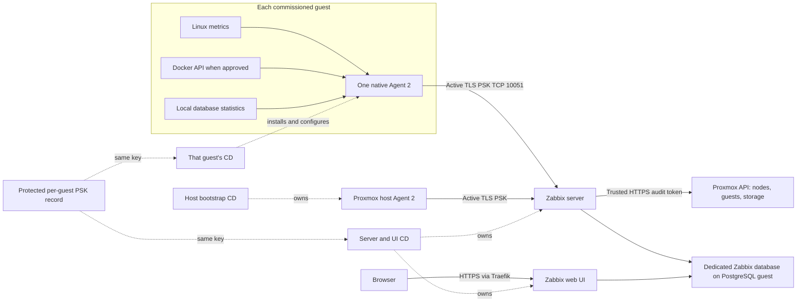

# Zabbix owned by guest CD

[Application guide](README.md) · [Bootstrap](../bootstrap/README.md) · [Database servers](DATABASES.md)

Reusable implementation belongs here; the private site repository supplies inventory,
secret references, network bindings and immutable source pins. This source does not
deploy a site. It prepares a clean installation without restoring Zabbix history.



The Proxmox API covers hypervisor inventory and resource statistics. An agent in
**each monitored guest** supplies guest OS and local workload metrics. Docker uses
that guest's single agent, not an agent in every application container. Special
appliances without a supported native agent need a separately selected HTTP/API
integration. A server on the same physical host cannot report while that host is off.

## Ownership and ordering

| Owning CD path | Responsibility |
| --- | --- |
| Proxmox bootstrap | Host Agent 2, audit-only Proxmox API identity and its narrow allowance |
| Each guest | Its native Agent 2, persistent PSK consumption, selected local plugins, monitoring DB account and Docker permission |
| PostgreSQL guest | Dedicated Zabbix database/owner and scoped database access, before server startup |
| Zabbix server/UI | Clean server/web deployment, pinned templates, finite host admission, UI password and readback |
| Future homelab-site integration | Private inventory, protected secret storage/recovery bindings, network contract, dependency ordering and source pin |

Guest monitoring does **not** call the Zabbix API or require the server to exist.
The PostgreSQL guest can commission its agent and monitoring session first. Agents
connect when the server becomes available; server CD later admits the same identity.
Existing guest lifecycle, trusted SSH, backup, saved-plan and durable failure-hold
rules remain the caller's responsibility. This PR does not add a central fleet rollout.

`ansible/guest-monitoring.yml` accepts exactly one host in `guest_monitoring` and
checks its hostname, machine ID, address, virtualization type and Debian 13 amd64
platform before changing it. Call it from that guest's existing commissioning or
reviewed maintenance job. The optional `app.zabbix_agent` hook also remains available
in `site.yml`. Newly generated machine IDs/credential records belong in a subsequent
commissioning step, not an already signed guest plan with a nonexistent secret file.
Use the standalone `monitoring-bootstrap.yml` agent entrypoint only from host CD.

The server adapter now requires **`schema: homelab-monitoring-cd-v2`** and has only
`bootstrap`, `server`, `configure`, `verify` phases. Bootstrap provisions audit API
access; it no longer installs a host agent. Configure imports templates and admits
hosts; it does not SSH into PostgreSQL, analyze its schema or install guest agents.
The retained `monitoring-database.yml`/`monitoring_database.py` helper belongs to the
PostgreSQL CD path. The old `agents` and `database` server phases are rejected.
Old private consumers must remain on their old source pin until explicitly migrated.

The adapter binds site/inventory/variables/SSH trust and recursively referenced
`*_file` inputs by SHA256, requires native trusted HTTPS, and retains local/NAS
holds on failure. Completed write phases are not replayed. A changed packet or
retained credential/configuration requires reviewed maintenance, not automatic adoption.

## Persistent agent secrets

`monitoring_credentials.py` creates a 256-bit PSK **once per commissioned guest**.
The public PSK identity combines hostname and machine ID. Both guest CD and server
CD read the same protected `credential.json`; neither generates a replacement during
a normal deploy. Hostname reuse with a different machine ID is a hold.

The controller's provision config is a private mode-0600 JSON file, for example:

```json
{
  "schema": "homelab-agent-secret-v1",
  "hostname": "example-guest",
  "machine_id": "aaaaaaaaaaaaaaaaaaaaaaaaaaaaaaaa",
  "store": "/protected/agent-credentials",
  "recovery": "/mounted/private-recovery",
  "backup_source": "nas.example.invalid:/private-recovery",
  "allow_create": true
}
```

Both root directories must already exist, owned by the CD user with mode 0700.
Recovery must be the **actual expected NFS mount**, checked using the existing
bootstrap backup guard; a lookalike local folder is refused. They must be distinct,
non-nested paths. Creation uses a lock, exclusive writes, fsync and holds in both
copies before generating the key. An interrupted/partial/mismatched copy stays held.
Repeat provisioning verifies both copies and reuses the original key. `allow_create`
is explicit commissioning authority; it can be false for subsequent jobs.

The helper prints only the identity/path and creation status. It neither prints the
PSK nor publishes GitHub/vault secrets. The protected store/recovery mechanism and
its private CD bindings must be admitted in homelab-site later. Never commit records,
passwords, generated plugin configs, secret-bearing CLI stdout or private job logs.
Credential recovery is distinct from backup of Zabbix's own history database.

Synthetic guest-CD variables (all referenced files are controller-local):

```yaml
zabbix_agent:
  hostname: example-guest
  address: 198.18.30.21
  machine_id: aaaaaaaaaaaaaaaaaaaaaaaaaaaaaaaa
  virtualization_type: lxc
  server_active: 198.18.30.50:10051
  version: '1:7.0.32-1+debian13'
  package_file: /protected/packages/zabbix-agent2.deb
  credential_file: /protected/agent-credentials/example-guest/credential.json
  secret_provision_file: /protected/example-guest-provision.json # optional; otherwise record must exist
  workloads:
    docker:
      socket_access_approved: true
```

Server CD uses that existing record, with no need to contact the guest:

```yaml
monitoring_hosts:
  - hostname: example-guest
    machine_id: aaaaaaaaaaaaaaaaaaaaaaaaaaaaaaaa
    credential_file: /protected/agent-credentials/example-guest/credential.json
    profiles: [linux, docker]
    profile_settings:
      docker:
        matches: '^/(web|worker)$'
        not_matches: '^/deploy-.*$'
```

Finite profile/filter selections belong to the same private guest inventory consumed
by both jobs. The public helpers validate selections, but do not reconcile independently
maintained inventories. Private integration must keep those inputs consistent.

## Workload profiles and credentials

`monitoring_profiles.py` provides `linux`, `docker`, `postgresql`, `mysql` (also
MariaDB), and `influxdb` selections. Agent connections initiate TCP 10051, omit
`Server`, open no passive 10050 listener, and deny `system.run`. OS-only config has
no plugin include. Workloads add exactly one fixed config file, not arbitrary vendor
include directories or custom commands.

Docker monitoring uses the standard plugin on `/var/run/docker.sock`. Access is
root-equivalent inside that guest and requires explicit `socket_access_approved`.
CD checks the existing root-owned `docker` group socket, adds only the agent user
to that group and does not loosen the socket mode or expose the daemon over TCP.
The upstream Docker template is passive; an in-memory derived template converts
collectors/discovery to active checks, renames it and assigns stable distinct UUIDv4
identities. It can coexist with the stock template. Review permanent/transient
container discovery filters before enabling alerts.

PostgreSQL and MySQL sessions use a dedicated **`zbx_monitor`** account. Guest input:

```yaml
zabbix_agent:
  # Include the identity/package/credential fields from the earlier example.
  postgresql_package_file: /protected/packages/zabbix-agent2-plugin-postgresql.deb
  manage_database_accounts: true
  workloads:
    postgresql:
      uri: tcp://127.0.0.1:5432
      password_file: /protected/example-postgresql-monitor-password
```

For MariaDB select `mysql`, use port 3306, and omit the PostgreSQL archive. Endpoint
IP must belong to this guest or be 127.0.0.1. Controller password files must be
owner-only mode 0600, containing a 32–128-character URL-safe password. The renderer
is an in-memory Ansible filter used only in `no_log` tasks; the CLI exposes only
the nonsecret profile catalog. Guest plugin
config is root:zabbix 0640. Server macros reference named session `homelab` with empty
user/password overrides, so database credentials stay off the Zabbix server.

`manage_database_accounts: true` is optional one-time commissioning for **one** local
native database. PostgreSQL commissioning requires a preapproved loopback session
and a responding local TCP listener before any account hold; remote HBA admission
stays with database CD. PostgreSQL grants `pg_monitor` without superuser, database/role
creation, replication or bypass-RLS. MariaDB grants statistics privileges
PROCESS/REPLICATION CLIENT/SHOW DATABASES/SHOW VIEW for this source IP, with three
connections. The helper refuses preexisting unowned identities, missing retained
accounts, receipt drift and interrupted operations. Authentication must succeed
before completing the ownership receipt; it never resets an existing password.
Database CD still owns backup/approval, trusted local admin access, HBA/listen rules,
privilege drift review and any future credential rotation. The helper does not edit
HBA, restart databases or adopt application-owner credentials. A failed new account
operation leaves ACCOUNT-HOLD for investigation.

InfluxDB uses the official HTTP template, rather than a remote database Agent 2
session. Server profile settings require an approved trusted **HTTPS origin** in
`url` and owner-only `token_file`. The API token is a Zabbix secret macro installed
without forced replay; use a minimum-privilege monitoring token. There is no implicit
plain-HTTP fallback or new database-network membership. A trusted route/CA and token
scope require later private integration and native readback.

## Pins and licensing

`monitoring/versions.json` pins official Zabbix **7.0.32** server/web container
manifests and all six unmodified upstream template files from commit
`0d6fa36d0a0df4552d8df07e5b13deb664089047`. The bundled AGPL licence and
[third-party notices](../../THIRD_PARTY_NOTICES.md) apply to those bytes. Runtime
copies enable peer/hostname verification for Proxmox and InfluxDB HTTP items.
Proxmox cluster-resource values retain one hour of history for fresh-value readback;
its seven HTTP item/prototype TLS settings are exported and checked after import.

Native Debian 13 amd64 packages are exact version `1:7.0.32-1+debian13`:

| Package | SHA256 |
| --- | --- |
| zabbix-agent2 | `d846b7f6b2eae0d5457decf6f0814df8169361d3335aa900d93e0eb838ab36e7` |
| zabbix-agent2-plugin-postgresql | `5d3d4ef1089c80cbefd52b4d8dc15aa9c4ab77b5678f8bf9952ca65f4c2983a2` |

Package URLs are in CI and `monitoring_profiles.POSTGRESQL_PLUGIN`.
`monitoring/collections.lock.json` pins upstream API modules and dependencies;
`install-collections.py` verifies their archives. Vendor startup is suppressed until
the complete agent config is installed and validated. Unexpected existing package,
PSK or plugin config is held before service convergence.

The audit-only Proxmox identity remains `homelab-zabbix@pve!monitoring`, privilege
separated with only Sys.Audit/VM.Audit/Datastore.Audit. The dedicated Zabbix PostgreSQL
owner remains distinct from the local `zbx_monitor` statistics reader. Server/web
consume file-backed database credentials; Traefik admits the UI after replacing the
factory administrator password. Shared database network/bootstrap contracts belong
to their owning implementation; no site addresses or bridge rules are embedded here.

## Validation and native admission

Source tests cover finite profiles, private credential protection, interrupted writes,
identity/recovery drift, template transforms and CD dependency/hold behavior. Isolated
Docker fixtures exercise fresh schema, all template imports, unchanged second API
configuration, canonical PSK reuse, active OS/Docker samples and wrong-key rejection.
Docker metrics use a synthetic API without mounting the host Docker socket. Separate
fixtures check the exact Debian binary and real PostgreSQL/MariaDB statistics sessions
using SQL rendered from the shared tasks. These establish source/container behavior.

Native acceptance still needs fresh commissioned identities and SSH trust; exact
reviewed plan/input hashes; backups; protected secret storage/recovery; local DB
privileges/HBA; guest Docker approval; Proxmox version/token/CA; firewall routes;
Traefik/DNS; supported LXC/systemd startup; fresh workload metrics; and browser sign-in.
`monitoring_verify.py` checks active OS/Proxmox freshness and HTTPS, not every optional
workload metric. Native workload acceptance must additionally read the selected
Docker/database items and investigate unsupported items. No native changes or
notification delivery are authorized by this source PR.

Official references: [Proxmox integration](https://www.zabbix.com/integrations/proxmox),
[Agent 2 configuration](https://www.zabbix.com/documentation/7.0/en/manual/appendix/config/zabbix_agent2),
[Docker integration](https://www.zabbix.com/integrations/docker),
[PostgreSQL integration](https://www.zabbix.com/integrations/postgresql),
[MySQL integration](https://www.zabbix.com/integrations/mysql).
