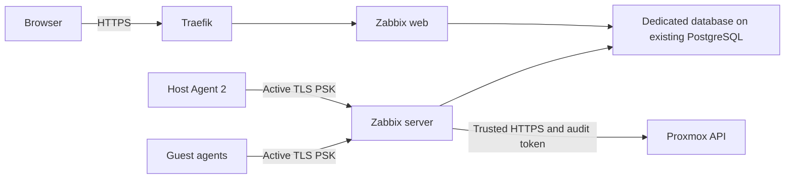

# A clean Zabbix server for Proxmox

[Application guide](README.md) · [Bootstrap](../bootstrap/README.md) ·
[Database servers](DATABASES.md)

This prepares a new monitoring system. It does not restore an old Zabbix database,
configuration or history. Source tests and Docker fixtures are separate from a
working installation on a physical Proxmox host.

The first deployment has one small, unprivileged Debian 13 LXC. Official Zabbix
server and web images run inside it. Its dedicated database lives on the existing
PostgreSQL guest. Traefik provides HTTPS for the web UI. Native Agent 2 runs on the
Proxmox host and each selected, commissioned guest.



The official **Proxmox VE by HTTP** template discovers nodes, guests and storage.
The official **Linux by Zabbix agent active** template supplies CPU, memory, swap,
filesystem, uptime and reachability metrics. Each agent has its own 256-bit PSK
and identity. Agents initiate TCP 10051 connections; their configuration omits
`Server`, so they do not open passive TCP 10050. `system.run` is denied and the
complete configuration includes no vendor plugin directories or custom commands.

This first deployment does not configure notification delivery, automatic
remediation, Docker socket access or application sensors. A server on the same
physical host cannot continue reporting while that host is off.

## What is pinned?

`monitoring/versions.json` pins matching Zabbix **7.0.32** x86 container manifests
and hashes of the two unmodified official template source files. At configuration
time, an in-memory copy explicitly enables peer and hostname verification on all
seven Proxmox HTTP items and prototypes. The standard module imports that copy
and exports it again for readback; the vendored bytes and UUIDs stay unchanged.
The cluster-resource master retains one hour of inventory values so the API's
history-backed `lastclock` and `lastvalue` can prove fresh native data. Other
upstream retention settings remain unchanged. Their source is commit
`0d6fa36d0a0df4552d8df07e5b13deb664089047` from the upstream `7.0.32` release.
The bundled AGPL licence applies to those templates; see the third-party notices.
The [7.0 support policy](https://www.zabbix.com/life_cycle_and_release_policy)
lists full support through June 2027. PostgreSQL 16 is within the
[supported database versions](https://www.zabbix.com/documentation/7.0/en/manual/installation/requirements).
The actual installed Proxmox version and native runtime still require acceptance.

Native Agent 2 uses the official Debian 13 amd64 package:

```text
https://repo.zabbix.com/zabbix/7.0/debian/pool/main/z/zabbix/zabbix-agent2_7.0.32-1%2Bdebian13_amd64.deb
Version: 1:7.0.32-1+debian13
SHA256: d846b7f6b2eae0d5457decf6f0814df8169361d3335aa900d93e0eb838ab36e7
```

`monitoring/collections.lock.json` pins upstream `community.zabbix` API modules
and their HTTP API dependencies. `install-collections.py` verifies the archives
and installs only those dependencies. Native agent installation uses shared
builtin Ansible tasks, with vendor service startup suppressed until the full
active-only configuration is validated.

## How CD owns the installation

The existing `deploy.py`, OpenTofu guest module, saved plan, trusted creation
identity, state recovery and failure holds remain the guest lifecycle path.
Only `kind: monitoring` with `installation: clean` may omit a capture. A clean
monitoring guest cannot accept a restore capture. Other application capture and
exclusive-writer requirements remain in place.

The small `monitoring_cd.py` adapter sequences fixed calls to that installer and
the existing Ansible/CD path:

| Phase | Work |
| --- | --- |
| Bootstrap | Dedicated API authority and narrow host API allowance; native host agent through bootstrap CD |
| Database | New database and restricted owner; one guest allowance and role-specific rejects before existing HBA rules |
| Server | Apply the exact reviewed new-guest plan, verify its SSH identity, render/start server and web |
| Configure | Analyze the fresh schema; import official templates; admit selected hosts and replace the factory admin password |
| Agents | Install the same shared native agent tasks on the commissioned guest inventory |
| Verify | Require fresh active PSK data from every selected host, fresh Proxmox values and a responding HTTPS UI |

The Proxmox user is `homelab-zabbix@pve`, with a privilege-separated `monitoring`
token. Its dedicated role contains only `Sys.Audit`, `VM.Audit` and
`Datastore.Audit`, propagated from `/` as required by the cluster template.
This reads the cluster; it cannot start/stop guests or change configuration.
Bootstrap stores the validated credential once in each protected local/NAS
location. An unexpected mint response is retained only as failed-attempt evidence
under the existing hold; successful setup has no redundant raw response file.
Publishing that credential into private GitHub secrets and the operator's vault
is a separately reviewed handover; the script never prints it or rotates it.

The PostgreSQL role is a login/owner for `zabbix`, without superuser, role/database
creation, replication or bypass-RLS privileges. Its HBA block permits only the
monitoring address to reach that database; it rejects other TCP and local-socket
connections for that role. Existing HBA lines are preserved byte for byte.
The helper checks the reviewed HBA digest, saves the original and globals, checks
the HBA parser and reloads PostgreSQL configuration without restarting it. Parser
or reload failure restores the original HBA file with its metadata, preserves the
rejected proposal and retains the failure hold.
An independently verified current native database backup is required first.

Private site inputs select addresses, guest IDs, domain, inventory and secret
bindings. Keep actual values and credentials out of public source. The database
password is file-backed in both containers. Runtime files are copied with the
official image user's UID 1997/GID 1995 and mode 0400. The server receives the
trusted Proxmox CA and the template macro `{$HTTP.TLS.VERIFY}=full`.
The CA is validated and mounted in the official image's `ssl/ssl_ca` input
directory. Its entrypoint copies it into the internal trust directory and builds
the OpenSSL hash links required by libcurl.

## Before enabling the private proposal

Keep it disabled and unmerged while the host is running its other operating
system. Approval of the design is not approval of a native rollout.

The exact native packet needs:

- Fresh Proxmox version, API/CA identity, unused VMID/addresses/MACs and resource budget.
- Trusted host keys and machine IDs for the host and commissioned guests; no dormant guest creation.
- Explicit host SSH/service authority for bootstrap CD and each selected guest.
- A current PostgreSQL backup verification and the exact existing HBA digest.
- Finite host/guest firewall changes for agent TCP 10051, API TCP 8006, database TCP 5432,
  Traefik TCP 8080, runner SSH and existing DNS/package egress. Existing commissioned
  guest firewalls need reviewed maintenance, not guest creation/replacement.
- A Traefik discovery route and DNS record, admitted after the factory password is replaced.
- New random database/admin credentials, a separate API token and individual agent PSKs,
  bound privately in GitHub and the operator's vault.
- The saved new-guest plan and SHA256; its application input files, CA and secrets
  are bound by digest. Recheck package availability before the native window.

The enabled adapter packet uses `schema: homelab-monitoring-cd-v1`, `site_file`,
`inventory`, `variables`, `ssh_key`, `known_hosts`, `plan_sha256` and
`input_sha256` for every native input file. Its `access` object points to the
bootstrap access config, existing bootstrap token, CA, local state and actual
NAS backup mount. Inventory groups are `monitoring_bootstrap`,
`monitoring_database`, `monitoring_api` and `monitoring_agents`.
Use trusted HTTPS for the native API inventory. Fixture-only HTTP overrides
must never appear in an admitted packet.

Bootstrap access readback deliberately keeps exact firewall snapshots. Later
rule/order/option drift requires a reviewed baseline update; it is not silently
adopted as legitimate peer maintenance. The native review must also approve token
lifetime and confirm the NAS export restricts access to the intended host/account
and protects the retained once-returned credential evidence.

The adapter keeps per-phase receipts and a durable hold on the existing local
and NAS state boundary. A failed or interrupted phase is not replayed on a later
push. An existing partial identity/database/agent configuration is held rather
than adopted or overwritten. Inspect and approve a separate correction through
PR, CI/review, merge and automatic CD. Do not dispatch Actions or patch targets.

## Adding later guests

Register a future guest's hostname and individual PSK through the same upstream
API configuration play. Include `app.zabbix_agent` in its private application
profile: `server_active`, `psk_identity`, `psk_file`, `package_file` and the exact
package `version` above. The existing new-guest guard supplies its verified
hostname/address, fresh machine identity and LXC type to the shared agent tasks.
The package and PSK file are bound to the guest plan. Existing guests instead
require their previously recorded machine ID in the fleet inventory. This does
not create, boot or enrol an uncommissioned guest.

## What testing establishes

The source suite checks clean-install admission, fixed services/images, secret
binding, input injection, HBA scope and failure holds. The disposable Docker
fixture uses an internal network with no published ports and synthetic secrets.
It exercises the rendered server/web against a fresh PostgreSQL schema, upstream
template/host modules, an unchanged second configuration run, active PSK data and
rejection of the wrong key. The exact Debian agent binary has a separate offline
configuration/process/no-passive-listener fixture.

Initial native acceptance can wait up to ten minutes for fresh samples within
one read-only attempt. Identity, TLS and unsupported-item errors fail immediately;
the wait never restarts a service or replays a failed phase.

These tests do not prove LXC nesting, host firewall paths, real Proxmox API data,
native systemd startup, every guest's telemetry, browser sign-in or household
acceptance. `monitoring_verify.py` is the later native readback; browser sign-in
still needs a human check.

Official references: [Proxmox integration](https://www.zabbix.com/integrations/proxmox),
[Agent 2 configuration](https://www.zabbix.com/documentation/7.0/en/manual/appendix/config/zabbix_agent2),
[container installation](https://www.zabbix.com/documentation/7.0/en/manual/installation/containers).
