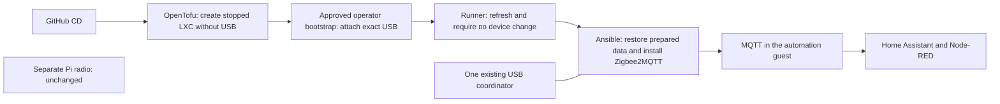

# Bring the existing Zigbee network to its own guest

[Application guide](README.md) · [Proxmox guide](../README.md)

This preparation moves the **Zigbee2MQTT instance and USB coordinator already on
Beast** into a separate, small Proxmox LXC. Home Assistant, Node-RED and MQTT stay
in the automation guest. A separate Zigbee2MQTT instance on a Raspberry Pi stays
where it is.

**Status: source preparation, not a completed migration.** The scripts have no
permission to stop the existing service, move a USB device, pair devices or
change your network. The private site proposal stays disabled until its missing
inputs and exact migration action are reviewed.

## What the scripts prepare

They reuse the existing single-guest deployment process in two explicit stages.
OpenTofu first creates an unprivileged, protected Debian guest **stopped, without
USB and without autostart**. A separately approved operator step attaches one
named USB serial device through the existing pinned bootstrap SSH connection.
The runner then refreshes its own state and refuses a plan that would add,
remove or change a device. The ordinary guests receive no devices. Ansible restores the saved
Zigbee data, uses an immutable image, and starts the selected Docker container
only after the guest network is ready and the migration's exclusive-writer
confirmation is present.

The entire Zigbee data directory is retained. Before creation, CD checks that
the capture contains its reviewed configuration, device database and coordinator
backup. Before startup it checks the restored bytes again. A missing or different
file stops deployment. It does not create a fresh Zigbee network to fill a gap.

CD **does not rewrite Zigbee configuration**. Prepare any necessary MQTT endpoint
or listener changes separately and review that copy before selecting its hashes.
The coordinator, network key, PAN identities, channel, device names and MQTT
base topic must remain the intended existing ones. Credentials remain private.
The checker accepts ordinary YAML and literal file-reference strings; custom
YAML tags need separate review rather than execution by the deployment checker.

## What you need before a migration

1. **The current data.** Take a coherent capture after stopping the old writer
   in the agreed window. Include all files beneath `zigbee2mqtt/`, especially
   `configuration.yaml`, `database.db` and `coordinator_backup.json`. Preserve
   owners, permissions and metadata. Choose its checksum and the three file
   checksums from the prepared copy; do not invent them. If the network key uses
   a quoted file reference, also include and hash that YAML file.
2. **The same image and coordinator.** Choose the existing image's verified
   registry digest or hashed local archive. Record the USB `/dev/serial/by-id/`
   identity. Changing firmware, image version or coordinator at the same time
   would add another migration risk and is outside this step.
3. **The reviewed guest inputs.** Select the unused guest ID, resource budget,
   management/backend addresses, exact packages (including `python3-yaml`), MQTT
   endpoint, existing topic and frontend port. Grant only the necessary guest,
   storage, interface and single-device access. No router changes are made here.
4. **A real test window.** Retire the old Beast instance before the new one can
   open that same radio. Check MQTT connection and a fresh report from a known
   device, then check an actual HA/Node-RED automation. A web page or retained
   `bridge/state=online` message alone does not prove the radio works.

For the stack input, use `kind: zigbee2mqtt`, one `services.zigbee2mqtt` entry and
the closed `zigbee` object shown in the synthetic unit fixture. Its fields are
`serial_device`, `bind_address`, `frontend_port`, `adapter`, `mqtt_server`,
`mqtt_base_topic` and `state_sha256`. The guest input's `serial_device.path` must
match. Docker maps that one device to `/dev/ttyACM0`, publishes the existing
frontend port only on the selected backend IPv4 address and binds the restored
data to `/app/data`. It adds no privileged mode, broad device rules or host
control sockets. The existing application guide explains the saved-plan and
failed-attempt hold behavior.

Declare exactly one guest interface with `role: backend`; `zigbee.bind_address`
must equal its static IPv4 address. The management address is not an alternative
listener. This annotation selects the listener without changing firewall rules.
The preserved identity requires a 16-byte network key, PAN ID from 1 to 65534
and an 8-byte extended PAN ID. A quoted `!secret.yaml network_key` reference is
also retained, as supported by [Zigbee2MQTT](https://www.zigbee2mqtt.io/guide/configuration/zigbee-network.html#specifying-network-key-in-a-different-file).
Its referenced YAML file must be in the data directory and have an additional
entry in `state_sha256`. The checker validates those captured bytes and their
16-byte key before creation and after restore, before startup. Missing files,
different hashes, links and generated/malformed referenced keys are refused.
Only a plain filename in that directory is supported; references to another
directory require separate preparation and review.
Other arbitrary identity strings and `GENERATE` are refused.

## The two source stages

The private application input must explicitly select `app.usb_stage`:

1. **`prepare`:** use the normal `plan` and reviewed `apply`. The generated
   OpenTofu variables omit the device and force `started: false` and
   `start_on_boot: false`. Only fresh creation is accepted. `stage`, `start` and
   the combined `deploy` entry point refuse this stage. The runner retains its
   state and records its lineage in `usb-prepared.json`.
2. **Operator attachment:** after reviewing the exact native action and retiring
   the old writer, use `zigbee_usb_operator.py` from the workstation with the
   existing bootstrap bundle, SSH key and verified known-hosts file. Its default
   operation is a live plan. Applying requires that exact plan hash and unchanged
   source, request, trust file, guest config digest and physical device metadata.
   It adds only `dev0` with the declared path, UID 0, GID 20, mode 0660 and write
   access. It leaves protection enabled and the guest stopped, then checks the
   readback and unchanged unrelated settings. A failure or timeout leaves an
   operator HOLD; there is no automatic retry, unprotection, credential/ACL
   expansion or replacement of an existing conflicting device.
3. **`attached`:** keep the same runner workspace and select this second stage
   in the private input. Run a new normal `plan`, which refreshes from Proxmox.
   It must show the exact device unchanged on both sides. Unknown, missing or
   changed device fields stop it. The reviewed `apply` saves that refreshed view
   in the same runner state and may start the LXC according to its reviewed
   guest inputs. It does not start Zigbee2MQTT. Continue through the existing
   guest host-key admission, `stage`, explicit `start` and `verify` steps.

The operator request is a closed JSON object with `node`, `vmid`, `hostname`,
`path`, `exclusive_writer_confirmed` and `native_action_approved`. The native
approval must be true before even using that command. The writer confirmation
must be true before attachment. These are inputs to a separately reviewed
migration packet, never inferred from synthetic tests or set by this preparation.

The command accepts `--bootstrap`, `--request`, `--ssh-key`, `--known-hosts` and,
for the single edit, `--apply PLAN_SHA256`. It uses only the management endpoint
and node already selected by the bootstrap bundle. It never copies workstation
OpenTofu state back to the runner or places the operator key on the runner.

Every attached-stage plan/apply/stage/start/verify reads the scoped API to check
the exact device and protected unprivileged guest. Ordinary image/application
updates retain that device declaration. Drift is a hold: there is no
`ignore_changes` or automatic USB repair. Device replacement or guest recreation
needs a new operator decision; deleting state or old receipts is not a recovery
procedure.

## What testing proves

The offline suite checks rendering, preserved-state refusal, exact device
selection, ordinary guests without devices, mock OpenTofu plans and Ansible
syntax. It uses invented data and never opens a coordinator. Upstream Proxmox restricts configuring LXC `devN` passthrough to `root@pam`;
ordinary guest-scoped ACLs alone do not admit this operation. Check the installed
PVE version before qualifying this two-stage host-side provisioning path.
The source flow has synthetic refusal/resumption checks, not native convergence
proof. Do not put a host root credential on the runner.
The host-to-LXC device path/ownership, Docker access and household radio
operation **still need the approved native test**. No physical USB success
is claimed from Docker CI.

The implementation follows the official [Zigbee2MQTT Docker guidance](https://www.zigbee2mqtt.io/guide/installation/02_docker.html)
and the pinned [Proxmox provider's container device interface](https://github.com/bpg/terraform-provider-proxmox/blob/v0.117.0/docs/resources/virtual_environment_container.md).

The USB permission restriction is visible in the official [Proxmox container source](https://github.com/proxmox/pve-container/blob/master/src/PVE/LXC.pm), in `check_ct_modify_config_perm`. Source inspection is not installed-host verification.
