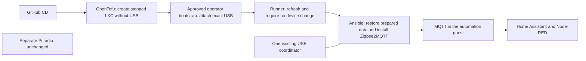

# Bring the existing Zigbee network to its own guest

[Application guide](README.md) · [Proxmox guide](../README.md)

This preparation moves the **Zigbee2MQTT instance and USB coordinator already on
Beast** into a separate, small Proxmox LXC. Home Assistant, Node-RED and MQTT stay
in the automation guest. A separate Zigbee2MQTT instance on a Raspberry Pi stays
where it is.

**Status: source preparation, not a completed migration.** The scripts have no
permission to stop the existing service, move a USB device, pair devices or
change your network. The private site proposal stays disabled until its missing
inputs and exact migration action are reviewed.

## What the scripts prepare

They reuse the existing single-guest deployment process in two explicit stages.
OpenTofu first creates an unprivileged, protected Debian guest **stopped, without
USB and without autostart**. A separately approved operator step attaches one
named USB serial device through the existing pinned bootstrap SSH connection.
The runner then refreshes its own state and refuses a plan that would add,
remove or change a device. The ordinary guests receive no devices. Ansible restores the saved
Zigbee data, uses an immutable image, and starts the selected Docker container
only after the guest network is ready and the migration's exclusive-writer
confirmation is present.

The entire Zigbee data directory is retained. Before creation, CD checks that
the capture contains its reviewed configuration, device database and coordinator
backup. Before the first startup attempt it checks the restored bytes again. A missing
or different file stops initial deployment. It does not create a fresh Zigbee network to fill a gap.

CD **does not rewrite Zigbee configuration**. Preserve the MQTT endpoint and
listener in the captured application file. A narrow `mqtt_host_alias` in the
stack maps that same broker hostname to its central deployment address. It
changes container name resolution, not Zigbee YAML. Any unavoidable service
configuration change needs separate reviewed SSH work; it is outside CD.
The coordinator, network key, PAN identities, channel, device names and MQTT
base topic must remain the intended existing ones. Credentials remain private.
The checker accepts ordinary YAML and literal file-reference strings; custom
YAML tags need separate review rather than execution by the deployment checker.

## What you need before a migration

1. **The current data.** Take a coherent capture after stopping the old writer
   in the agreed window. Include all files beneath `zigbee2mqtt/`, especially
   `configuration.yaml`, `database.db` and `coordinator_backup.json`. Preserve
   owners, permissions and metadata. Choose its checksum and the three file
   checksums from the prepared copy; do not invent them. If the network key uses
   a quoted file reference, also include and hash that YAML file.
2. **The same image and coordinator.** Choose the existing image's verified
   registry digest or hashed local archive. Record the USB `/dev/serial/by-id/`
   identity. Changing firmware, image version or coordinator at the same time
   would add another migration risk and is outside this step.
3. **The reviewed guest inputs.** Select the unused guest ID, resource budget,
   management/backend addresses, exact packages (including `python3-yaml`), MQTT
   endpoint, existing topic and frontend port. Grant only the necessary guest,
   storage, interface and single-device access. No router changes are made here.
4. **A real test window.** Retire the old Beast instance before the new one can
   open that same radio. Check MQTT connection and a fresh report from a known
   device, then check an actual HA/Node-RED automation. A web page or retained
   `bridge/state=online` message alone does not prove the radio works.

For the stack input, use `kind: zigbee2mqtt`, one `services.zigbee2mqtt` entry and
the closed `zigbee` object shown in the synthetic unit fixture. Its fields are
`serial_device`, `bind_address`, `frontend_port`, `adapter`, `mqtt_server`,
`mqtt_base_topic` and `state_sha256`. The guest input's `serial_device.path` must
match. Docker maps that one device to `/dev/ttyACM0`, publishes the existing
frontend port only on the selected backend IPv4 address and binds the restored
data to `/app/data`. It adds no privileged mode, broad device rules or host
control sockets. The existing application guide explains the saved-plan and
failed-attempt hold behavior.

Declare exactly one guest interface with `role: backend`; `zigbee.bind_address`
must equal its static IPv4 address. The management address is not an alternative
listener. This annotation selects the listener without changing firewall rules.
The preserved identity requires a 16-byte network key, PAN ID from 1 to 65534
and an 8-byte extended PAN ID. A quoted `!secret.yaml network_key` reference is
also retained, as supported by [Zigbee2MQTT](https://www.zigbee2mqtt.io/guide/configuration/zigbee-network.html#specifying-network-key-in-a-different-file).
Its referenced YAML file must be in the data directory and have an additional
entry in `state_sha256`. The checker validates those captured bytes and their
16-byte key before creation and after restore, before startup. Missing files,
different hashes, links and generated/malformed referenced keys are refused.
Only a plain filename in that directory is supported; references to another
directory require separate preparation and review.
Other arbitrary identity strings and `GENERATE` are refused.

## The two source stages

The private application input must explicitly select `app.usb_stage`:

1. **`prepare`:** use the normal `plan` and reviewed `apply`. The generated
   OpenTofu variables omit the device and force `started: false` and
   `start_on_boot: false`. Only fresh creation is accepted. `stage`, `start` and
   the combined `deploy` entry point refuse this stage. The runner retains its
   state and records its lineage in `usb-prepared.json`.
2. **Operator attachment:** after reviewing the exact native action and retiring
   the old writer, use `zigbee_usb_operator.py` from the workstation with the
   existing bootstrap bundle, SSH key and verified known-hosts file. Its default
   operation is a live plan. Applying requires that exact plan hash and unchanged
   source, request, trust file, guest config digest and physical device metadata.
   It adds only `dev0` with the declared path, UID 0, GID 20, mode 0660 and write
   access. It leaves protection enabled and the guest stopped, then checks the
   readback and unchanged unrelated settings. A failure or timeout leaves an
   operator HOLD; there is no automatic retry, unprotection, credential/ACL
   expansion or replacement of an existing conflicting device.
3. **`attached`:** keep the same runner workspace and select this second stage
   in the private input. Run a new normal `plan`, which refreshes from Proxmox.
   It must show the exact device unchanged on both sides. Unknown, missing or
   changed device fields stop it. The reviewed `apply` saves that refreshed view
   in the same runner state and may start the LXC according to its reviewed
   guest inputs. It does not start Zigbee2MQTT. Continue through the existing
   guest host-key admission, `stage`, explicit `start` and `verify` steps.

The operator request is a closed JSON object with `node`, `vmid`, `hostname`,
`path`, `exclusive_writer_confirmed` and `native_action_approved`. The native
approval must be true before even using that command. The writer confirmation
must be true before attachment. These are inputs to a separately reviewed
migration packet, never inferred from synthetic tests or set by this preparation.

The command requires `--revision FULL_REVIEWED_COMMIT` and
`--signer-fingerprint SHA256:APPROVED_SSH_SIGNER`. The native action packet must
approve that fingerprint independently of the selected commit and workstation
Git trust settings; do not discover the approved value from the commit being
checked. The command compares the signature fingerprint with this explicit pin.
It also verifies that this is
the checkout's HEAD, that Git accepts its signature using the operator's existing
trusted signers, and that both executed source files match that commit byte for
byte. A branch name, unsigned commit, different signer or modified helper is
refused before SSH. The operator plan binds the approved fingerprint too.
Review the selected SSH key's authority for this root action in the native
packet. The pinned SSH host key authenticates the target; the reported hostname
is only an additional node consistency check.

The command accepts `--bootstrap`, `--request`, `--ssh-key`, `--known-hosts` and,
for the single edit, `--apply PLAN_SHA256`. It uses only the management endpoint
and node already selected by the bootstrap bundle. It never copies workstation
OpenTofu state back to the runner or places the operator key on the runner.

Every attached-stage plan/apply/stage/start/verify reads the scoped API to check
the exact device and protected unprivileged guest. Ordinary image/application
updates retain that device declaration. Drift is a hold: there is no
`ignore_changes` or automatic USB repair. Device replacement or guest recreation
needs a new operator decision; deleting state or old receipts is not a recovery
procedure.

## Explicit first-start approval

The `start` step and `exclusive_writer_confirmed` do not themselves authorize a
first radio startup. Supply a separately reviewed `app.zigbee_first_start_approval`
record. It defaults to absent/denied and CD must never generate or approve it.
The closed record contains:

- `schema: 1` and literal `approved: true` after the human decision;
- `capture_sha256`: the reviewed archive digest;
- `selection_sha256`: the canonical SHA256 of the selected closed `zigbee` object;
- `restore_receipt_sha256`: SHA256 of the exact complete private restore receipt;
- `exclusive_writer_window`: `id`, literal `confirmed: true`, and UTC
  `not_before`/`expires_at` values in `YYYY-MM-DDTHH:MM:SSZ` form.

The window must be current and no longer than 24 hours. Its confirmation means
the old writer has been retired for this selected startup. The existing writer
assertion still runs first. Bind the final record into the reviewed private site
input and saved plan; adding it after staging requires reviewing the changed
input through the ordinary plan path. Never patch inputs behind a saved receipt.
Missing, false, expired, future, malformed or mismatched approval refuses startup
without creating an admission receipt. Staging can still check the initial
bytes without admitting startup.

The version2 admission receipt seals the approved record's digest and window ID
alongside capture, selection and network identity. Once admitted, later reviewed
starts need that same private receipt and identity; they do not reopen the first
writer window or require reapproving legitimately mutable live database state.
An older version1 or damaged receipt remains a hold requiring separate review.
Do not delete or rewrite it to force a new first admission. Admission remains
separate from startup success and does not clear controller HOLD evidence.

Human security review must cover the new record and workflow selection, exact
cluster API read exception/token scope, rendered backend listener and coordinator
mapping. Synthetic fixtures do not authorize firewall activation, native USB
access or a migration window. The inert private radio proposal remains disabled.

## What testing proves

The offline suite checks rendering, preserved-state refusal, exact device
selection, ordinary guests without devices, mock OpenTofu plans and Ansible
syntax. It uses invented data and never opens a coordinator. Upstream Proxmox restricts configuring LXC `devN` passthrough to `root@pam`;
ordinary guest-scoped ACLs alone do not admit this operation. Check the installed
PVE version before qualifying this two-stage host-side provisioning path.
The source flow has synthetic refusal/resumption checks, not native convergence
proof. Do not put a host root credential on the runner.
The host-to-LXC device path/ownership, Docker access and household radio
operation **still need the approved native test**. No physical USB success
is claimed from Docker CI.

The implementation follows the official [Zigbee2MQTT Docker guidance](https://www.zigbee2mqtt.io/guide/installation/02_docker.html)
and the pinned [Proxmox provider's container device interface](https://github.com/bpg/terraform-provider-proxmox/blob/v0.117.0/docs/resources/virtual_environment_container.md).

The USB permission restriction is visible in the official [Proxmox container source](https://github.com/proxmox/pve-container/blob/master/src/PVE/LXC.pm), in `check_ct_modify_config_perm`. Source inspection is not installed-host verification.

Zigbee has no direct SQL or InfluxDB dependency. This flow preserves its existing
vmbr30 MQTT/application path and requires no database-network change or bridge
31/32/33 interface.

## Firewall admission before radio work

The radio runner reads `/cluster/firewall/options` before each plan, apply,
stage, start or verify. An unset/disabled cluster firewall or unreadable API
response stops the step before OpenTofu or Ansible. In the attached stage it
also requires the selected guest firewall to be enabled with DROP input and
output policies. These checks do not enable a firewall or change permissions.
An active firewall daemon, per-NIC flag or saved rule declaration alone is not
proof that cluster-level enforcement is enabled. Native acceptance must still
verify the selected engine and effective packet path.

The API helper permits this one exact cluster read for Zigbee only; other
cluster paths and ordinary application kinds retain their existing restriction.
The API allowlist change is a security control for explicit human source review.

The private packet must include the runner's read permission for the cluster
options endpoint. Proxmox requires `Sys.Audit` at `/`; prepare the minimum
non-propagating read grant for separate common-infrastructure review. Do not
add a root credential, silently broaden a token or enable the host firewall
from an application job. Existing guest-scoped access alone may return 403.

Select both ends of the application traffic in private source: radio egress
to one MQTT broker /32 and port, and that broker guest's matching ingress from
the radio backend /32. Select frontend API clients and any existing ingress
proxy separately on the retained frontend port. Do not assume that adding the
radio's outbound rule also admits it at the broker. Preserve the MQTT topic
and authentication; no database bridge or new physical network is required.

## First-start admission and later starts

Staging checks the exact captured bytes without creating startup admission.
The explicit start step first requires the retired-writer confirmation. After
checking the complete restore receipt and exact prepared hashes, it writes one
private, durable `zigbee-admission.json` before Compose can open the radio. This
records capture/selection and network-identity digests, never raw key material.
It is admission of initial state, not proof of startup success; a failed attempt
still retains the controller HOLD and cannot replay itself.

On a later reviewed start, the same complete restore and admission receipts
must match. The checker reads bounded regular files and verifies the selected
adapter, MQTT endpoint/topic, serial path, frontend and sealed network key,
PAN/extended-PAN and channel. Database and coordinator-backup counters and other
non-identity settings may have changed during normal operation. The checker
never restores original bytes over that live data. The existing restore receipt
continues to prevent re-extraction. Missing/changed receipts, a different capture
or selection, identity drift and changed referenced-key files remain holds.
Deleting a receipt is not an admission or recovery procedure: unadmitted data
must again match the initial capture hashes. Native runtime acceptance remains
separate from the synthetic repeated-start fixture.

## Permanent ordinary deployment after admission

`zigbee_ordinary.py` supplies radio policy to the shared `ordinary_cd.py` engine.
The shared engine owns locks, operation receipts, backups, failure holds and
unchanged completion. The radio adapter has no parallel controller. Its two
visible phases are infrastructure and application. It cannot restore a capture,
attach/replace USB, approve first startup or clear an interrupted operation.

Before a changed operation can plan/apply, the adapter requires the original
runner state and USB preparation lineage, effective firewall readback and the
unchanged exact device. A read-only Ansible preflight checks the previously
accepted private checker, restore/admission receipt hashes, selected facts and
live network identity before package or infrastructure changes. The same check
runs before application reconciliation. Mutable database/counter changes remain
valid. The ordinary input contains admission metadata, not a restore request or
first-start permission. An already completed matching operation uses the shared
unchanged/no-contact path.

A missing radio or missing custody is an admission hold: the existing stopped
creation, separately reviewed operator attachment and separately prepared data /
first-start procedure must complete before ordinary radio CD is enabled. The
permanent job survives that one-time migration. It never recreates a missing
physical-radio guest or imports an unrelated state to make the job pass.

The private called workflow is `.github/workflows/radio.yml`, with one job named
Radio 209 and visible OpenTofu/Ansible steps. It remains explicitly disabled.
Its actual dependency is automation200's MQTT service; it has no direct database
bridge or dependency. Parent graph integration belongs to the shared source
owner and must consume the disabled parent snippet once.

The combined source includes the reviewed shared ordinary implementation from
HomeLab #24, preserving commit `388db5876811fc2780f07b41235967e5ce8d158b`, and
its owner's `GUEST_ADAPTER_API = 1` extension. The production Compose flow imports
the dedicated admission tasks exactly once, after writer approval and before
startup; the fixture follows that real import. The radio adapter refuses a
source without this reviewed interface. Human security review and native
acceptance remain separate from source preparation.

The selected broker alias is deployment addressing only. The checker still
requires the captured MQTT URL, keys, PANs, channel, device names and topic. No
source helper edits the application YAML or converts these settings.
