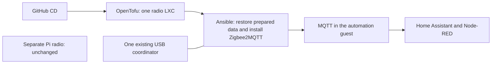

# Bring the existing Zigbee network to its own guest

[Application guide](README.md) · [Proxmox guide](../README.md)

This preparation moves the **Zigbee2MQTT instance and USB coordinator already on
Beast** into a separate, small Proxmox LXC. Home Assistant, Node-RED and MQTT stay
in the automation guest. A separate Zigbee2MQTT instance on a Raspberry Pi stays
where it is.

**Status: source preparation, not a completed migration.** The scripts have no
permission to stop the existing service, move a USB device, pair devices or
change your network. The private site proposal stays disabled until its missing
inputs and exact migration action are reviewed.

## What the scripts prepare

They reuse the existing single-guest deployment process. OpenTofu creates an
unprivileged, protected Debian guest and passes through **one named USB serial
device**. The ordinary guests receive no devices. Ansible restores the saved
Zigbee data, uses an immutable image, and starts the selected Docker container
only after the guest network is ready and the migration's exclusive-writer
confirmation is present.

The entire Zigbee data directory is retained. Before creation, CD checks that
the capture contains its reviewed configuration, device database and coordinator
backup. Before startup it checks the restored bytes again. A missing or different
file stops deployment. It does not create a fresh Zigbee network to fill a gap.

CD **does not rewrite Zigbee configuration**. Prepare any necessary MQTT endpoint
or listener changes separately and review that copy before selecting its hashes.
The coordinator, network key, PAN identities, channel, device names and MQTT
base topic must remain the intended existing ones. Credentials remain private.
The checker accepts ordinary YAML and literal file-reference strings; custom
YAML tags need separate review rather than execution by the deployment checker.

## What you need before a migration

1. **The current data.** Take a coherent capture after stopping the old writer
   in the agreed window. Include all files beneath `zigbee2mqtt/`, especially
   `configuration.yaml`, `database.db` and `coordinator_backup.json`. Preserve
   owners, permissions and metadata. Choose its checksum and the three file
   checksums from the prepared copy; do not invent them.
2. **The same image and coordinator.** Choose the existing image's verified
   registry digest or hashed local archive. Record the USB `/dev/serial/by-id/`
   identity. Changing firmware, image version or coordinator at the same time
   would add another migration risk and is outside this step.
3. **The reviewed guest inputs.** Select the unused guest ID, resource budget,
   management/backend addresses, exact packages (including `python3-yaml`), MQTT
   endpoint, existing topic and frontend port. Grant only the necessary guest,
   storage, interface and single-device access. No router changes are made here.
4. **A real test window.** Retire the old Beast instance before the new one can
   open that same radio. Check MQTT connection and a fresh report from a known
   device, then check an actual HA/Node-RED automation. A web page or retained
   `bridge/state=online` message alone does not prove the radio works.

For the stack input, use `kind: zigbee2mqtt`, one `services.zigbee2mqtt` entry and
the closed `zigbee` object shown in the synthetic unit fixture. Its fields are
`serial_device`, `bind_address`, `frontend_port`, `adapter`, `mqtt_server`,
`mqtt_base_topic` and `state_sha256`. The guest input's `serial_device.path` must
match. Docker maps that one device to `/dev/ttyACM0`, publishes the existing
frontend port only on the selected backend IPv4 address and binds the restored
data to `/app/data`. It adds no privileged mode, broad device rules or host
control sockets. The existing application guide explains the saved-plan and
failed-attempt hold behavior.

## What testing proves

The offline suite checks rendering, preserved-state refusal, exact device
selection, ordinary guests without devices, mock OpenTofu plans and Ansible
syntax. It uses invented data and never opens a coordinator. Upstream Proxmox restricts configuring LXC `devN` passthrough to `root@pam`;
ordinary guest-scoped ACLs alone do not admit this operation. Check the installed
PVE version and agree a narrow host-side provisioning path before connecting
this to a restricted runner. Do not put a host root credential on that runner.
The host-to-LXC device path/ownership, Docker access and household radio
operation **still need the approved native test**. No physical USB success
is claimed from Docker CI.

The implementation follows the official [Zigbee2MQTT Docker guidance](https://www.zigbee2mqtt.io/guide/installation/02_docker.html)
and the pinned [Proxmox provider's container device interface](https://github.com/bpg/terraform-provider-proxmox/blob/v0.117.0/docs/resources/virtual_environment_container.md).

The USB permission restriction is visible in the official [Proxmox container source](https://github.com/proxmox/pve-container/blob/master/src/PVE/LXC.pm), in `check_ct_modify_config_perm`. Source inspection is not installed-host verification.
