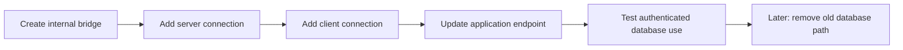

# Private networks for database guests

[Proxmox guide](../README.md) · [Application deployment](README.md) · [Bootstrap](../bootstrap/README.md)

Each database gets its own small network inside Proxmox. Only that database
server and the guests that use it join the network. Management, internet access
and application traffic keep their existing connections.

An **internal bridge** is a virtual switch inside Proxmox. It needs no cable,
router address or UniFi VLAN. Guest database interfaces have a static address,
no VLAN tag and no gateway. They do not replace the management interface.

## Put the network choices in one place

Keep a private `networks/databases.json`, following the
[example](examples/database-networks.example.json). It lists each bridge's
purpose, subnet, database server and allowed client guests. Actual site values
belong in your private deployment repository.

The reusable [renderer](database_networks.py) derives guest interfaces, database
endpoints and exact client firewall rules from that file. Service-specific CD
uses the same file and pins its hash in its reviewed inputs. It must not keep a
second, separately maintained list of database addresses.

| Owner | What it maintains |
| --- | --- |
| Host bootstrap | Internal bridges, their purpose descriptions and the deployment token's declared bridge permissions |
| Database guest CD | The server's database interface, listener and client access rules |
| Application guest CD | That client's database interface, connection setting and outbound rule |

The bootstrap renderer accepts `--database-networks` to add the declared bridges
to its host configuration. This option leaves commissioned application profiles
unchanged. Existing bootstrap inputs without that option retain their original
behavior. Bridge descriptions are saved in Proxmox's **Comment** field.

## Move an existing service in stages

Keep the old database connection available until its clients work through the
new one. Append interfaces so existing interface names and the management
default route stay intact. Application HTTP and MQTT traffic can still use the
old shared application bridge; splitting databases does not remove that bridge.

For an installed server, use a reviewed maintenance operation. **Do not rerun
its initial deployment or restore its database just to change networking.** The
existing database CD deliberately refuses changed installation inputs and later
runs only verification. This renderer does not bypass that protection.

PostgreSQL needs its listener and allowed client addresses updated together.
MariaDB host-specific grants also need checking. InfluxDB keeps its existing
organization, buckets and tokens. Do not replace application credentials as
part of this move.

## What is proved by these checks?

Source tests exercise the contract, finite membership, generated interfaces,
firewall rules and bootstrap reconciliation. They check one network reload,
repeat runs without changes and refusal of unrelated host edits. These checks
do not prove that a bridge exists on your server or that an application can use
its new connection. Record those results after the approved CD run.
