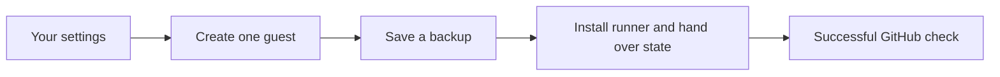

# Start the first deployment guest

[Back to the Proxmox guide](../README.md) · [Installation USB](../iso/README.md)

Run this after installing Proxmox. You will create one small Debian container,
connect it to your private GitHub repository, and run a job that confirms GitHub
has taken over.

**OpenTofu** creates the container. **Ansible** installs its tools and GitHub
**runner**, the service that receives jobs. No database is required. Other guests
and application deployment come later.



## What you need

- A Mac or Linux workstation with [this repository](../../README.md#1-get-a-copy-on-your-computer),
  Git, Python **3.10 or newer**, Docker, OpenSSH (`ssh`, `ssh-keygen`,
  `ssh-keyscan`) and [GitHub CLI](https://cli.github.com/).
- A newly installed, reachable x86-64 Proxmox host, with
  [its disks, networking and SSH access checked](../host-access.md).
- A private GitHub deployment repository that you administer, with Actions enabled.
  This is a separate repository from this public source checkout.
- A Debian 13 **amd64 LXC template**: a compressed `.tar.zst` archive, not an ISO
  or a VM disk image. See step 3.
- An existing private NAS mount on the workstation for the initial state backup.

If a workstation tool is missing, use its official setup instructions:
[Python](https://www.python.org/downloads/),
[Docker Desktop](https://docs.docker.com/desktop/), or
[GitHub CLI](https://cli.github.com/). Install OpenSSH through your Linux
distribution if needed; macOS includes its command-line tools.

On a Mac, use Docker Desktop with Linux containers. Apple Silicon uses AMD64
emulation. Allow the first Docker image build time to finish; it downloads tools.
Check that Docker's selected context points to the local engine you intend to use.

Run the following from the **repository root**, not `proxmox/iso`:

```sh
python3 --version
docker context show
docker version
gh auth status
```

**Expected result:** Python is recent enough, Docker reports both Client and
Server, and GitHub CLI reports the account that administers your private repository.
If needed, run `gh auth login` and follow its browser sign-in. No extra personal
GitHub token needs to be pasted into settings.

If you finished the ISO guide in the same terminal, return to the root with
`cd ../..`. The root contains this project's main README and the `proxmox` folder.

## 1. Practise without touching Proxmox

```sh
./proxmox/bootstrap/bootstrap test
./proxmox/bootstrap/bootstrap test-backend
```

**Expected result:** both finish successfully. The first prints an evidence-file
path and a `PASS` summary; the second reports local-state qualification results.
The Docker image build uses the internet, but the test containers then run with
networking disabled. They do not contact Proxmox, your NAS or GitHub.

If either fails, stop and use the troubleshooting table below. These local
checks cannot prove your physical host or a real GitHub registration works.

## 2. Fill in your private settings

Use the same terminal throughout so the variables below remain available.
These commands create private copies of the two example files:

```sh
umask 077
bootstrap_private="$HOME/.config/homelab-bootstrap"
mkdir -p "$bootstrap_private"
cp -n proxmox/bootstrap/site.example.json "$bootstrap_private/site.json"
cp -n proxmox/bootstrap/settings.example.json "$bootstrap_private/settings.json"
```

Open those copies in a text editor, such as TextEdit in plain-text mode on a Mac.
JSON uses double quotes and commas between entries, with no comma after the last
entry. Leave the checked-in example files unchanged.

### Carry your ISO settings into bootstrap

The table is **one invented worked example**, consistent with the ISO's
`config/site.example.json`. Replace it with your own values. The
`198.18…` addresses and `example.invalid` hostname are not ready-made home settings.

| Field in the private copy | Worked example | Where to find your value |
| --- | --- | --- |
| `site.json → site.node` | `pve` | Run `hostname -s` on the installed host. |
| `site.api_endpoint` | `https://pve.example.invalid:8006/` | Your ISO hostname, resolving to the management address. Include HTTPS and port 8006. |
| `site.ssh_public_keys` | Your public key's type and long value | The same Ed25519 public key used in the ISO; omit its comment. |
| `guests[0].vmid` | `900` | Choose an unused guest ID; check the Proxmox resource list first. |
| `guests[0].storage_id` | `local-zfs` | The active guest storage shown by `pvesm status`. The ISO uses a ZFS mirror; do not assume the example's generic `local-lvm` applies. |
| `guests[0].interfaces[0].bridge` | `vmbr0` | The administration bridge made by this ISO. |
| `guests[0].interfaces[0].vlan` | `25` | Your ISO's `management.vlan`. This ISO uses tagged management; replace the generic example's `null`. |
| `guests[0].interfaces[0].mac` | `02:00:00:00:09:00` | Choose a locally administered MAC not already used on your network. |
| `guests[0].interfaces[0].ipv4` | `198.18.25.10/24` | An unused, reserved management-subnet address for this guest; keep it different from the host. |
| `settings.json → repository` | `your-account/private-site` | Your private GitHub repository's owner/name. |
| `runner_name` | `homelab-deploy` | A unique descriptive name for this runner. |
| `admin_cidr` | `198.18.25.0/24` | The subnet from which you will SSH to the guest; it can differ from the guest's subnet. |
| `prefix_length`, `gateway`, `dns_servers` | `24`, `198.18.25.1`, `["198.18.25.53"]` | Your guest's subnet size, router and DNS server addresses. |

For a static address, reserve it outside your DHCP allocation or reserve it in
your network manager. DHCP is also supported: set `ipv4` to `"dhcp"`; its gateway
comes from DHCP. Use your DNS servers or `[]` to inherit the host's DNS.
**Ongoing deployment needs a stable guest address**, through a static address or
DHCP reservation; the host firewall rule follows an address, not a changing lease.

Leave the guest key `deploy`, unprivileged-container type and deletion protection
as supplied. Its default size is **1 CPU, 1 GiB RAM and 8 GiB disk**. The script
excludes IDs 4914, 4915 and 4920 for this project's protected rehearsal guests.

## 3. Select the Debian template

If a Debian 13 amd64 LXC template already exists on the host, use its full
storage identifier in `template_file_id`. Find it under the host's template
storage in the Proxmox web interface, or list existing templates at its console
with `pveam list local`. This lists files; it does not download anything.

For the automatic workstation-to-host upload:

1. Open the [official Proxmox template directory](https://download.proxmox.com/images/system/)
   and select a Debian 13 standard **amd64** `.tar.zst` archive. Save it outside
   the public checkout. Keep its vendor checksum/signed-index evidence and verify
   it against that trusted source before using it.
2. Record the full local file path and exact filename. On a Mac, print its SHA-256
   with the command below, replacing the path. On Linux, use `sha256sum`.
3. Add the `template` object below **inside** your private `settings.json`, beside
   `repository` and the other settings. Add a comma after the preceding entry.
4. Set `site.json → guests[0].template_file_id` to
   `local:vztmpl/YOUR_EXACT_TEMPLATE_FILENAME.tar.zst`.

```sh
shasum -a 256 /YOUR/PRIVATE/PATH/debian-template.tar.zst
```

```json
"template": {
  "file": "/YOUR/PRIVATE/PATH/debian-template.tar.zst",
  "sha256": "REPLACE_WITH_THE_64_CHARACTER_SHA256",
  "file_name": "debian-template.tar.zst",
  "datastore_id": "local"
}
```

The filename and storage must match `template_file_id`. Use the real filename
throughout; `debian-template.tar.zst` is only an illustration. A checksum you
calculate identifies those downloaded bytes; it does not independently verify
their publisher. Keep the trusted vendor evidence too. See the vendor's
[template manager reference](https://pve.proxmox.com/pve-docs/pveam.1.html).

Preparation checks and privately copies the selected archive. The later
`access` step uploads it over verified SSH, checks it again and refuses to
overwrite different bytes. No manual template upload is needed. The bootstrap
does not download archives through the Proxmox API or create storage/bridges.

## 4. Verify host access and prepare the bundle

Follow [host access and checks](../host-access.md). It shows the actual commands
to compare the host's fingerprint at its console and on your workstation.
Keep `HOMELAB_SSH_KEY` and `HOMELAB_KNOWN_HOSTS` exported in this terminal.

The key must work non-interactively; the current launcher does not forward an SSH
agent. The linked guide explains the dedicated-key requirement.

Prepare a **new** working directory:

```sh
./proxmox/bootstrap/bootstrap prepare \
  --catalog "$bootstrap_private/site.json" \
  --settings "$bootstrap_private/settings.json" \
  --out "$bootstrap_private/first-run"
bootstrap_bundle="$bootstrap_private/first-run/bundle"
```

**Expected result:** preparation prints a result and creates the final `/bundle`
directory. It builds the local Docker tools image, then prepares files with
networking disabled. It has not yet changed Proxmox. Existing output directories
are preserved; use a new name for a genuinely new attempt after inspecting any
earlier failure.

## 5. Create API access, review the plan and create the guest

The next command **changes the host**: it uploads your selected template when
needed and creates a scoped API token. This example token expires after **six
hours**. Choose the intended lifetime before running it. For ongoing CD, read
[credential lifetime and rotation](OPERATIONS.md#credential-lifetime-and-rotation);
expiry prevents future Proxmox API jobs, even if the runner stays online.

**Choose before copying the command:** `21600` is the six-hour practice setting.
For an ongoing runner, use your agreed lifetime instead. `0` means no automatic
expiry and requires your deliberate acceptance of that choice and its revocation
procedure. Do not run `access` twice to change a token already created.

```sh
./proxmox/bootstrap/bootstrap access "$bootstrap_bundle" --expires-in 21600
./proxmox/bootstrap/bootstrap plan "$bootstrap_bundle"
```

**Expected result:** access reports `"status": "ready"`; plan reports
`"status": "passed"` with the location of its saved plan. Credentials and the
trusted Proxmox CA are saved privately, so no token copy/paste is needed.

The API token is the deployment guest's Proxmox credential, separate from the
root recovery password. Save the token from the private bundle's `access.json`
in your password manager alongside your SSH key and recovery password. Keep
that file private; it contains a usable credential, not a shareable log.

Read the plan on your workstation:

```sh
cat "$bootstrap_bundle"/operations/plan-*/plan.stdout
```

Confirm the selected host, unused guest ID, template, storage, bridge and VLAN.
The expected new infrastructure is **one deployment container with its guest
firewall resources**. If the plan includes replacements, deletions or unrelated
resources, stop. Plan logs are private.

When the plan matches your intended setup, apply those saved bytes:

```sh
./proxmox/bootstrap/bootstrap apply "$bootstrap_bundle"
./proxmox/bootstrap/bootstrap verify "$bootstrap_bundle"
```

**Expected result:** both report `"status": "passed"`; verification includes
`"provider_noop": true`, meaning a fresh plan needs no changes. In Proxmox,
your selected guest is running and protected against deletion. It starts again
after a host reboot.

## 6. Back up, then hand over to the runner

**State** is the private file OpenTofu uses to remember the guest it created.
The NAS backup directory's parent must already exist and be privately mounted
on your workstation. Replace the path below; the final directory must be new:

```sh
./proxmox/bootstrap/bootstrap backup "$bootstrap_bundle" \
  /YOUR/MOUNTED/NAS/private/bootstrap-before-handover
```

**Expected result:** a private backup with a matching state checksum. This copies
state/configuration, not SSH keys, cached tools or plans. It does not mount the
NAS or prove a path is NAS-backed; check the actual mount yourself.

Now install the runner and transfer the active state:

First complete the [workflow-trust checks](OPERATIONS.md#runner-trust-and-one-way-handover)
for repository access, protected workflow changes and fork jobs. Do not register
the runner if untrusted code can reach it.

```sh
./proxmox/bootstrap/bootstrap runner "$bootstrap_bundle"
```

The script adds the selected guest-to-host TCP **8006** allowance on the
**Proxmox host**, installs tools, checks API access and registers the runner.
It preserves other host rules and does not change NAS/router firewalls or VLANs.
The API hostname must resolve to one IPv4 address assigned to this host.

**Expected result:** runner setup succeeds, and GitHub shows your configured
runner online. A local `HANDOVER.json` freezes workstation plans/applies.
The guest now owns the active state. The workstation and NAS copies are recovery
snapshots and do not automatically stay current.

Only trusted, reviewed workflows may run here: every job on this runner can read
its scoped Proxmox API token. Your personal GitHub token and workstation SSH
private key are not installed as deployment credentials. Keep repository access
restricted; labels select runners and do not provide access control.

See [runner trust and handover](OPERATIONS.md#runner-trust-and-one-way-handover)
for failure handling. Step 8 connects the NAS recovery folder and declares which
application guests this runner may create.

## 7. Confirm GitHub has taken over

In your **private deployment repository** on GitHub:

1. Open **Settings → Actions → Runners**. Find your configured runner name and
   check that it is **Idle/online**.
2. Open this checkout's
   [workflow example](templates/private-bootstrap-preview.yml.example) in a text
   editor. Change the final `homelab-deploy` label in `runs-on` to your
   `runner_name` if different.
3. In the private repository, choose **Add file → Create new file**. Name it
   `.github/workflows/bootstrap-preview.yml` and paste the reviewed example.
   Review and commit it through your repository's normal process to `main`.
   Never put this self-hosted workflow in the public source repository.
4. Open **Actions → Bootstrap handover preview → Run workflow**, select
   `main`, then run it.
5. Open the new run and its **plan** job. Confirm it ran on your new runner and
   succeeded with a no-change verification result.

**You are finished when:** the guest is running, verified SSH access works, the
private runner is online, and the GitHub job succeeds using the transferred
state. A no-change plan means GitHub can see the same guest without trying to
recreate it. It does not deploy your household applications.

## 8. Prepare the runner to deploy your applications

**Already bootstrapped? Start here.** There is no need to reinstall Proxmox,
recreate the deployment guest or register another runner. This is the supported
configuration step for both a new setup and an existing one.

Copy [deployment.example.json](deployment.example.json) to your private settings
folder as `deployment.json`. Its values are invented; replace them:

| Setting | What to enter |
| --- | --- |
| `applications` | The guest IDs, existing disk/template storage, bridges and VLANs your runner will manage. Add one entry per planned application guest. |
| `nas.server`, `nas.export` | Your NAS address and its existing NFS shared-folder path. The NAS must permit this Proxmox host as a client. |
| `nas.version` | The NFS version supported by that share, for example `4.1`. The script does not guess another version. |
| `nas.directory` | A new dedicated backup folder inside that share, private to this deployment runner. Do not select an existing application-data folder. |
| `restart_deploy` | Use `true` to allow one graceful restart of **only the deployment guest** if the new shared folder needs it. Leave `false` when no restart is intended. |
| `temporarily_unprotect_deploy` | Proxmox blocks adding a mount to a protected guest. Choose `true` only to allow protection off during this guest's one mount addition; the script immediately restores and verifies it, including after a failed addition. It defaults to `false`. |

Proxmox mounts the export and shares only that backup folder into the
unprivileged guest, at `/srv/homelab-backups`. The script creates the missing
configuration, adds only the declared application permissions, keeps the same
API token and creates a separate guest-local SSH key for application deployment.
The workstation's powerful operator key stays on the workstation. It does not
change your NAS export rules, router, VLANs or existing application data.

Keep the existing bundle and SSH environment from step 4. With the runner idle:

```sh
./proxmox/bootstrap/bootstrap configure "$bootstrap_bundle" \
  "$bootstrap_private/deployment.json"
```

**Expected result:** a read-only plan listing missing permissions and NAS setup,
plus `plan_sha256`. Review it, then copy that exact fingerprint below:

```sh
./proxmox/bootstrap/bootstrap configure "$bootstrap_bundle" \
  "$bootstrap_private/deployment.json" --apply THE_PRINTED_PLAN_SHA256
```

**Expected result:** `"status": "configured"`. The script checks NAS write and
readback as the actual deployment account, saves the runner's active state to
the NAS, and verifies that OpenTofu still proposes no guest changes. The normal
application jobs save their state before and after each deployment step.
These are **infrastructure recovery copies**; application/database data needs
its own NAS protection before migration.

The NAS must be available when this deployment guest starts. The shared folder
can delay or prevent its start during a NAS outage, and an in-progress backup
can wait for the NAS to return. Proxmox itself can still boot. Restore NAS
availability before restarting the runner; do not replace the NAS mount with a
local folder to make a failed backup appear successful.

You can repeat this plan/apply pair with the same settings. It preserves the
guest, registration, key, token and state; completed setup does not add another
mount or restart. Changed inputs require a newly reviewed plan. A failed or
interrupted configuration leaves `CONFIGURATION-HOLD.json` and blocks app jobs;
inspect the actual outcome before authorising a corrected attempt.

An expired token is not silently extended. See the
[credential reference](OPERATIONS.md#credential-lifetime-and-rotation) before
deliberately selecting a new absolute `expires_at` timestamp.

Continue with the [application deployment plan](../applications/README.md).
Keep this runner dedicated to deployment: PegaProx is planned in its own LXC.

## 9. Let GitHub maintain the host prerequisites

Once guest900 and its NAS backup are working, GitHub can prepare the private
backend network and access for your next guests. You do not need to reinstall
Proxmox, refresh the installation USB or recreate the deployment guest.


This option gives **bootstrap CD a separate Proxmox Administrator API token**.
That credential can administer the host. Only enable it if you trust the private
repository, its main-branch changes and its deployment runner. The regular
application token keeps its individual guest permissions; the operator SSH key
stays on your workstation. The CD token has no expiry and can be revoked in
Proxmox under **Permissions → API Tokens**.

Run the normal bootstrap command from your workstation, using the same private
bundle and SSH environment variables from step 4:

```sh
./proxmox/bootstrap/bootstrap cd-access \
  --bundle "$bootstrap_private/bundle" \
  --out "$bootstrap_private/cd-access"
```

**Expected result:** `status: ready`. The command creates one separated API
token, saves a private copy, and uploads it with your existing GitHub CLI login
to the private repository's `homelab-bootstrap` environment as
`PROXMOX_BOOTSTRAP_TOKEN`. That environment allows deployments from `main` only.
A completed setup can be checked again without changing its token. Save its
private copy in your password manager. A partial setup stops for inspection;
do not delete its folder to force another attempt.

In the private repository, adapt [the example host settings](cd-host.example.json)
and add a main-branch push workflow that checks out this public source at a
reviewed **full commit SHA**. Use environment `homelab-bootstrap`, your private
runner labels, `contents: read`, and the same concurrency group as your application
jobs. Pass the environment secret only to this step:

```yaml
- name: Configure host prerequisites
  env:
    PROXMOX_BOOTSTRAP_TOKEN: ${{ secrets.PROXMOX_BOOTSTRAP_TOKEN }}
  run: python3 public-source/proxmox/bootstrap/bootstrap_cd.py --config bootstrap/host.json
```

Replace every example address, node, MAC, application ID and NAS source. The
`existing_grants` list must match the current application token's saved grants;
it is an explicit baseline, not a request for more permissions. Each declared
application adds access only to that guest ID. The bridge adds only its network
permission. Existing storage and management-network access must already be in
the baseline. This small implementation expects the standard deployment guest900.

**Merge the reviewed configuration PR.** The job creates an isolated bridge with
no physical port, configured host address or gateway. That backend network stays
inside Proxmox; it needs no switch/UDM VLAN or DHCP server. Give backend guests
fixed addresses when their application CD creates them. The job does not create,
start, stop or restart a guest and does not change token lifetimes.

Proxmox applies this addition through its normal network reload. Do not edit
host networking in the web interface during the job. Any already pending change,
unexpected interface change, occupied guest ID, missing NAS mount or permission
drift stops it. A successful repeat makes no further changes. A failure leaves
the plan, a hold and a maintenance marker on the runner, with receipts on NAS;
review the outcome before a separately approved correction. Other deployment
jobs must check that maintenance marker before proceeding.

## When something goes wrong

| What you see | What to do |
| --- | --- |
| Docker cannot connect | Start your local Docker engine and check `docker context show`. Retry only a step confirmed not to have started. |
| Template, settings or JSON validation fails | Check the private copies, exact filename/hash and the ISO-to-bootstrap table. Do not change runtime code to accept a bad value. |
| SSH fingerprint or authentication fails | Follow [host access](../host-access.md); never disable strict host checking. |
| Output, token or access-attempt file already exists | Preserve it and inspect the previous result. A new folder does not clear a partial host operation. |
| Token has expired | The guest may still run, but API jobs fail. Follow the [credential reference](OPERATIONS.md#credential-lifetime-and-rotation); do not silently replace access. |
| Creation reports `403` or missing `SDN.Use` for a VLAN | Stop and preserve the failed attempt. A tagged guest needs permission at its exact bridge/VLAN path. See the [physical-run correction](verification.md#physical-host-bootstrap-passed-after-a-correction-on-25-october-2026); do not substitute broad permissions or retry blindly. |
| Apply times out or leaves `HOLD.json` | Keep state and logs. Inspect the actual guest and partial operation before another attempt; do not delete the hold. |
| Equivalent host API rule belongs to someone else | Inspect the conflict. The script will not adopt or overwrite it. |
| Runner setup fails after `HANDOVER.json` appears | Preserve the marker and reconcile the guest's actual state. Do not restart from the workstation copy. |
| GitHub job stays queued | Check the exact `runs-on` labels, runner availability, private repository and `main` branch. |
| GitHub reports changes | Inspect the private provider plan and state identity; do not apply automatically to make verification pass. |

## What has actually been verified?

On **25 October 2026**, both a fresh isolated Proxmox 9.2 machine and the
maintainer's physical host reached a successful real GitHub no-change check.
The physical run exposed a missing permission for a tagged VLAN. After one
reviewed correction and retry, its guest, backup, transferred state and GitHub
job matched. **70 unit tests passed** for the corrected bootstrap source.

The clean lab run and corrected physical run are separate results. The latter
used an explicitly approved private Mac snapshot for initial handover; it did
not establish a NAS backup. Application rollout and ongoing NAS state backup
on that physical host remain outstanding.

On **26 October 2026**, step 8 passed on the existing isolated lab deployment
guest: NAS write/readback, active-state recovery copies and the next application
guest's API access were checked. Repeating the configuration made no Ansible
changes and left OpenTofu with a no-change plan. The guest and runner were
retained. **94 bootstrap unit tests passed.** That lab result does not update
the physical host or prove its NAS path.

See [verification evidence and limits](verification.md).
Maintainers can use the
[operating reference](OPERATIONS.md) for credential, firewall, locking and
failure-path details.
