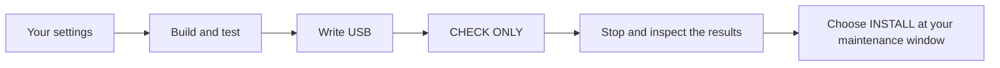

# Make a Proxmox installation USB

[Back to the combined Proxmox guide](../README.md)

This guide helps you build a custom Proxmox installer, practise its checks in a virtual machine, and put it on a USB drive. An **ISO** is the bootable image that goes on the USB.

Start with the practice run below. It uses invented hardware details and does not give the test container access to physical disk devices. You can then supply your own settings and build the real image.

## Does this fit your setup?

This package supports one specific layout:

- **Two new SSDs** for Proxmox. They become a mirror: the same data is stored on both.
- **One original system disk** that must remain present and untouched.
- **Two wired network ports**: one for administration and one for storage and application networks.
- **UEFI boot**, the modern boot mode available in your computer's firmware settings.

Your switch must already support the numbered networks, called **VLANs**, in your settings. This package does not configure the switch. If your disk or network layout differs, stop here: changing example values is not enough to support a different layout.

The USB starts in **CHECK ONLY**. That checks the computer and disks, then stops. To install, you must choose **INSTALL**, check the displayed drive serial numbers, and type the exact requested confirmation. Installation erases the two selected new SSDs. There is no automatic progression from CHECK ONLY into installation.

If you explicitly list a trusted Thunderbolt network adapter in your hardware settings, both boot modes authorise that adapter before checking the hardware. CHECK ONLY still makes no installation writes to the SSDs.



After installation and the host checks below, follow the
[first deployment guest guide](../bootstrap/README.md). OpenTofu creates that
guest and Ansible installs its GitHub runner. Other guests and application setup
follow through later deployment jobs.

## What you need

- A checkout of this repository.
- Docker running. On a Mac, use Docker Desktop with Linux containers. Building the installer uses an x86-64 Linux container; Apple Silicon Macs need Docker's x86-64 emulation enabled.
- Git and `make`. On macOS these are available with Apple's Command Line Tools. The build itself does not require installing Linux utilities or Python packages on the Mac.
- Internet access for the first download, including a roughly **1.7 GB** vendor ISO. Allow about **40 GB** of free build space for downloads, intermediate images and tests.
- A USB drive of at least **8 GB** whose contents you are happy to erase, for the real installation stage.

If Docker is not installed, start with the official
[Docker Desktop setup](https://docs.docker.com/desktop/). Wait until it reports
that its engine is running before starting the commands below.

The documented automatic USB-writing helper currently supports **macOS**. The Docker build can also be used on Linux; this package does not supply a Linux or Windows USB-writing helper. Follow the [vendor's installation-media guide](https://pve.proxmox.com/pve-docs/pve-admin-guide.html#installation_prepare_media) for those systems. Do not translate a Mac disk name into a Linux command by guesswork.

If you have not downloaded the repository, use the
[main README's clone commands](../../README.md#1-get-a-copy-on-your-computer).
Then, from the repository root, run:

```sh
cd proxmox/iso
pwd
```

The printed path should end in `homelab/proxmox/iso`. **All commands below run
from this folder**, on your workstation, unless a step says otherwise. You can
open `.local/` in your file manager or text editor; a leading dot makes it hidden
in many file managers. On a Mac, Command–Shift–Period shows hidden files in Finder.

## 1. Try it safely first

Run these commands in order, waiting for each one to finish:

```sh
make tools
make init
make fetch
make unit
make fixture
make test-boot
```

| Command | What it does | What you should see |
| --- | --- | --- |
| `make tools` | Creates the two Docker tool images. | Docker finishes both builds without an error. |
| `make init` | Creates private local-settings files. Existing files are preserved. | A message saying `.local/` is ready. |
| `make fetch` | Downloads and checks the exact supported Proxmox release and helper. | “Vendor ISO, helper and native runtime verified”. |
| `make unit` | Checks the code and configuration rules. | The test summary ends with `OK`. |
| `make fixture` | Builds a practice ISO using invented disks and network identities. | A build receipt with a SHA-256 checksum. |
| `make test-boot` | Boots that image in disposable virtual machines, one at a time. | Five cases pass, each reporting `no_target_disk_writes: true`. |

The boot tests check a matching computer, the wrong computer, a missing disk, duplicated disk identities, and cancelled confirmation. They can take several minutes. These tests stop before an actual installation. **Do not put the practice image on your real installation USB.**

If a command fails, use [When something goes wrong](#when-something-goes-wrong) below. Do not continue past a failed check.

### Checks on GitHub

Every pull request runs the source tests in Docker. Changes to this ISO package also run **Proxmox ISO build and boot checks**: one job builds the practice image and runs its five VM cases; another builds with invented integration settings, checks vendor metadata and verifies wrong-machine refusal. The jobs use GitHub-hosted Linux runners and the same Docker/`make` commands as this guide. They need no homelab access or private site inputs.

Build/test receipts and VM console output appear in the final evidence step in each job's logs, including when a check fails. Images, virtual disks and local credential files are not uploaded. These CI checks cover the synthetic workflow; your real image still needs its own local tests and `make qualify` before USB preparation. Physical installation and first-start networking remain separate.

## 2. Collect your computer's details

Do this while the original Linux system is still available. The following script only reads hardware information; it does not install or change anything:

```sh
sh scripts/show-hardware.sh
```

If you are building on a different computer, copy just that script to the intended Linux target and run it there. You may be asked for that Linux computer's administrator password to read its machine identifier.

Keep the output private. Use it to complete `.local/hardware.json`:

| Setting | What to enter |
| --- | --- |
| `machine_uuid` | The computer's long machine identifier printed by the script. |
| `disk_members` | The two new SSDs: each serial number, its full `/dev/disk/by-id/…` alias, and its exact capacity in bytes. |
| `protected_disks` | The original system disk, with the same three details. There must be exactly one. |
| `interface_names` | The two physical port MAC addresses. Assign the administration port to `mgmt0` and the faster/storage port to `fast0`. These are the names used after installation. |
| `thunderbolt_devices` | Leave `[]` for ordinary built-in/USB ports. For a Thunderbolt Ethernet adapter you explicitly trust, enter its stable `unique_id` and the same MAC used in `interface_names`. |

Use the serial number to match each alias to its disk. Do not use an alias ending in `-part1` or another partition number. Do not enter “1 TB” as the capacity: copy the exact byte count. Current names such as `nvme0n1` can change at the next boot; the installer checks persistent identities instead.

If you cannot positively identify a disk or port, stop and resolve that before building your real image.

### If your network adapter uses Thunderbolt

A fresh installer may see a Thunderbolt adapter but withhold access until it is authorised. Its existing Ubuntu authorisation does not configure the new installation. On the intended Linux computer, read the attached device names and identities:

```sh
grep -H . /sys/bus/thunderbolt/devices/*/{device_name,unique_id}
```

Match the external adapter's name to its ID, then add an entry to `.local/hardware.json`. This invented example must be replaced with your adapter's values:

```json
"thunderbolt_devices": [
  {
    "unique_id": "22222222-2222-4222-8222-222222222222",
    "mac": "02:00:00:00:10:02"
  }
]
```

Listing an adapter grants that particular device PCIe/DMA access on the selected computer. The installer checks the embedded code and settings, machine identity and UEFI mode before authorising it, then waits for its expected Ethernet MAC. It leaves other Thunderbolt devices and firmware security settings alone. An unauthorised device in `secure` mode requires its existing secure trust rather than an automatic downgrade.

The installed system uses the same check before networking on every boot. If the selected adapter is missing or its MAC does not appear, startup reports a failure instead of treating another adapter as a replacement. The check is required by the networking service, so a failure can leave **both ports without network access**, including the administration port. You will need the host's local keyboard/screen to investigate.

If a newly authorised adapter fails its MAC check, the helper attempts to revoke
only that new authorisation after checking its identity again. Existing grants
are preserved. A failed revocation is reported explicitly because access may
remain. Revocation disconnects the device, so select a dedicated Ethernet
adapter rather than a dock carrying storage; see the [kernel's explanation](https://docs.kernel.org/admin-guide/thunderbolt.html#de-authorizing-devices).

## 3. Fill in your local settings

Open the files inside `.local/` with a text editor. The checked-in files in `config/` are examples; leave them unchanged.

### Computer and network settings

Edit `.local/site.json`:

- Set your full hostname, such as `pve.yourdomain.example`, and notification email.
- Set the keyboard, country and timezone that suit you.
- Enter the management address, gateway, DNS server and VLAN number.
- Enter the storage address and VLAN number. Only management gets a default gateway.
- List the VLANs allowed on each physical port in `admin_vlans` and `fast_vlans`. The two lists must not overlap.

Addresses use the form `192.0.2.10/24`: the `/24` is the network size. Example addresses in this package are deliberately unsuitable as a ready-made configuration for your home. Ask whoever manages your network if you are unsure which addresses or VLANs to use. Do not copy the examples into a production network unchanged.

[Configuration reference](docs/configuration.md) explains every field and shows how the ports, bridges and VLANs relate.

### Sign-in details

If you do not already have a suitable SSH key, follow
[prepare your SSH key](../host-access.md#1-have-a-key-ready-before-building-the-iso)
first. It explains the public/private files and the current bootstrap's
non-interactive key requirement. Use that same public key for the ISO and the
later deployment guest.

Save the recovery password and your SSH private key in your password manager.
Keep the private key outside this folder; the ISO build uses only the public
key. The shared host/guest public key is intentional for this initial bootstrap.
During that later step, the launcher mounts the private key read-only into
Docker for non-interactive SSH; it is not installed in the guest or runner.

**Check access before switching off your old system.** If that system hosts your
password manager, make sure the saved recovery password and private SSH key are
available from an unlocked offline vault or another protected copy. Test that
access now; needing the old server to retrieve its replacement's key will stop
you halfway through installation.

1. Copy your existing **public** SSH key into `.local/root-ssh.pub`. This version requires the single line beginning `ssh-ed25519`. Copy the key type and long key value; omit any trailing comment. Do not copy a file beginning `BEGIN … PRIVATE KEY`.
2. Create a strong recovery password in your password manager, then run:

   ```sh
   make password-hash
   ```

   Enter the password twice when prompted. It is not displayed. This saves a one-way password **hash** in `.local/root-recovery-password.hash`, not the password itself. The command refuses to overwrite an existing hash.

3. Edit `.local/media-approval.json`. Replace `REPLACE_WITH_YOUR_NAME` with your name. Leave its scope and `production_boot_or_erase_authorized: false` unchanged. This records your decision to prepare media; choosing an actual installation remains a separate step.

Files created by `make init` have restrictive permissions. If you copied credential files using another program, correct their permissions before building:

```sh
chmod 700 .local
chmod 600 .local/*.json .local/root-ssh.pub .local/root-recovery-password.hash
```

The `.local/`, `build/` and `evidence/` folders are excluded from Git. The Docker **image-build context** contains only its Dockerfiles. Running build containers reads the local settings you deliberately supply. The finished real ISO contains hardware/network settings, the public key and the password hash; treat the USB as private installation media.

## 4. Build and check your real image

After all local settings are complete:

```sh
make build
make test-profile
make qualify
```

- `make build` validates the settings, checks the vendor inputs, creates the real ISO, reads back its embedded files, and checks that other vendor filesystem metadata was preserved.
- `make test-profile` boots this exact image on the deliberately wrong virtual computer. It must refuse with `wrong machine UUID` and zero target-disk writes.
- `make qualify` checks that the practice tests and this real-image test passed for the **current** image hashes. It creates the acceptance record required by the USB helper.

Your real image is:

```text
build/single-usb-production/Proxmox-9.2-1-production.iso
```

The matching `build-receipt.json` records its size and checksum. A SHA-256 checksum is a long identifier for the exact file contents. A changed checksum means a different image.

This build deliberately refuses to replace an existing final image. If you need a revised build, keep the earlier output as a record, rename its `build/single-usb-production` folder, and build again. New images need new matching tests and acceptance. Do not delete failure receipts to force a check to pass.

## 5. Put it on the USB — macOS

**Everything already on the selected USB will be erased.** Disconnect other external physical drives first. These commands must run on the Mac, outside Docker.

List the available external drives:

```sh
make usb-list
```

Find your USB by its **model and size**. In the following commands, `/dev/disk4` is only an example. Replace it with your actual whole-disk name. Do not use a partition such as `/dev/disk4s1`.

```sh
make usb-inspect USB=/dev/disk4
make usb-check USB=/dev/disk4
```

The first command records the USB's identity without changing the device. Check its displayed model and capacity. The second checks the image, test results, USB identity and original partition layout; it prints **READ-ONLY CHECK PASSED** and makes no device writes.

When those details are correct, run:

```sh
make usb-write USB=/dev/disk4
```

Enter your **Mac administrator password in Terminal** if asked. Do not put it in configuration files or chat.

Wait for all of the following: write progress, full-image readback, and the final result containing `usb_ready: true`, `readback_verified: true`, and `ejected: true`. Then you may unplug the USB. The receipt is saved in `evidence/usb-write-receipt.json`.

The helper refuses internal disks, changed identities, insufficient capacity and an existing USB-operation receipt. If writing fails, leave the receipt intact and review the error. A partially written USB is not ready to boot. Do not immediately rerun the writer.

## 6. Boot and install — at your chosen maintenance window

Building or testing the ISO does not shut down the target computer. Plan that interruption separately.

Before booting the USB, check your cables and switch settings:

- Plug each cable into the exact switch port you configured, and label the
  administration cable so the two ports are easy to distinguish.
- Carry the management VLAN **tagged** on that port and every connecting
  switch/router uplink. A cable link can be up while the VLAN path is wrong.
- Make sure your workstation's network can reach Proxmox on TCP **8006** for the
  web interface and TCP **22** for SSH. It can stay on your normal home network
  if your routing/firewall permits that access.

The ISO creates the host-side network configuration. It does not configure any
switch or router for you. See the [network settings reference](docs/configuration.md).

1. Boot the USB in **UEFI** mode.
2. Use its default **CHECK ONLY** entry first. Read the listed new-disk serial numbers and the protected original. A successful check ends at a stop screen; it does not install anything.
3. When you are ready to erase the two new SSDs, reboot the USB and select **INSTALL**. Confirm that the displayed serials are the intended new drives. Type the exact phrase requested on screen, including those serial numbers. A wrong answer or five-minute timeout stops the operation.
4. Successful installation powers the machine off. Remove the USB, select the new Proxmox boot entry, and start the machine.
5. Follow [host access and checks](../host-access.md) for the console commands,
   fingerprint comparison and workstation SSH test. Check both wired ports,
   management/storage addresses, the new mirror and the preserved original disk
   before moving on to guests or applications.

The typed confirmation in step 3 is expected. This is an attended installation:
having your settings on the USB does not remove that final drive check.

If you plan to return to the preserved original system between stages, use your
firmware's boot menu to select it. While Proxmox is running, applications that
only exist on the original system are off; installing Proxmox does not move them.

The first-start network script checks both expected port identities before writing its configuration. It preserves the vendor-created interfaces file and refuses a repeated run. It does not configure switch ports or firewalls.

For a configured Thunderbolt adapter, first start also installs `homelab-thunderbolt.service`, required before `networking.service` on every boot. This keeps adapter authorisation automatic after future restarts.

## When something goes wrong

| What you see | What to do |
| --- | --- |
| Docker unavailable or cannot connect | Start Docker Desktop/the Docker service, wait until it is ready, and rerun that command. |
| Download, checksum or signing-key mismatch | Stop. Keep the failed files and output. Check the release pins and vendor sources; do not disable verification or substitute a newer release. |
| Partial download already exists | Inspect the incomplete `.download` file and failure before deciding how to retry. It is never used as a verified ISO. |
| Incomplete vendor preparation or changed derived vendor input | Stop and keep the files. Review the failure and the `build/vendor-inputs.json` receipt before preparing fresh derived inputs. |
| Missing or unsupported local settings | Recheck `.local/` against the field reference. Replace all `REPLACE…` markers and example hostnames. |
| Protected input has group/other permissions | Apply the `chmod` commands in step 3. |
| An output folder already exists | Preserve and rename that earlier build folder; do not automatically remove failed evidence. |
| A VM test fails or times out | Stop. Its `build/vm-tests/…` folder contains the receipt and console log. A running/queued test is not a pass. |
| USB identity changed | Stop. Check whether it was disconnected, moved to another port or renumbered. Do not substitute another disk automatically. |
| USB write failed or readback differs | Keep the USB-operation receipt and error. Do not boot it or replay the write until the failure is understood. |
| Installer says `HOMELAB_REFUSED` | It has stopped before launching the native installer. Check the reason and the actual hardware; do not relax the guard to make the message disappear. |
| Thunderbolt adapter is connected but its network interface is missing | Check its device name, `unique_id`, `authorized` value and domain security in the local console. Add only the adapter you explicitly trust to your hardware settings and rebuild/test the ISO. |
| First-start network does not work | Use the local console and review the saved network file, port identities and switch VLANs. Do not rerun the first-start script blindly. |

Raw logs can include private settings. Redact them before sharing; the `verification/` folder contains the shareable summaries.

## What has actually been verified?

See [verification status](verification/README.md) for the separate virtual-test
and physical-installation results. A physical installation and first-start access
were checked on the maintainer's host on **25 October 2026**. Switch-port and
uplink VLAN corrections were needed; those are documented as setup issues, not
proof that the installer configures your network. Your own computer still needs
its disk, network and access checks.

The download and build steps check exact supported inputs, but different build times and Debian package updates can produce a different final ISO checksum. This is a repeatable workflow, not a promise of byte-identical builds. Each resulting image gets its own checksum, readback and tests.

For maintainers: [technical design and supported version pins](docs/technical-reference.md).

## Next: create the deployment guest

Once installation is complete and the host checks in step 6 pass, continue to
the [bootstrap guide](../bootstrap/README.md). It takes you from the installed
Proxmox host to one deployment guest and a private GitHub runner, including the
job that confirms the handover.

For the full sequence and current readiness status, return to the
[combined Proxmox guide](../README.md).
