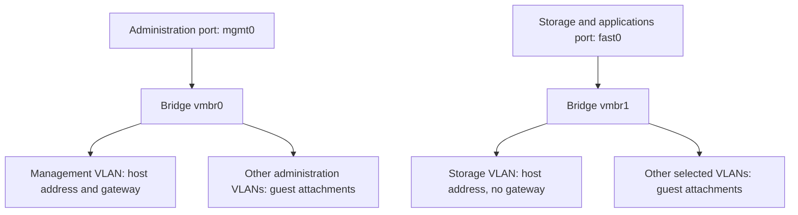

# Configuration reference

All real settings go in the ignored `.local/` folder. The files under `config/` remain redacted examples. JSON requires double quotes around names and text, commas between entries, and no trailing comma after the final entry.

## Hardware: `.local/hardware.json`

| Field | Meaning | Rule |
| --- | --- | --- |
| `machine_uuid` | The identifier of the intended computer. | Exact UUID from the intended target. |
| `disk_members` | The two new installation drives. | Exactly two different whole disks. |
| `protected_disks` | The original disk to preserve. | Exactly one, distinct from both new disks. |
| `disk_serial` | A drive's serial number. | Exact literal value; no wildcard patterns. |
| `disk_by_id` | Stable whole-drive alias. | Full `/dev/disk/by-id/…` path, without a partition suffix. |
| `disk_size_bytes` | Exact drive capacity. | An integer copied from the byte-count inventory. |
| `interface_names` | Physical MAC address to installed interface name. | Exactly one `mgmt0` and one `fast0`. |

Both serial and alias must identify the same unique disk during the installer boot. Its byte capacity must also match. A missing protected disk causes a refusal, even if the new disks match.

## Site: `.local/site.json`

| Field | Meaning |
| --- | --- |
| `schema` | Leave `homelab-iso-site-v1` unchanged. |
| `fqdn` | Full hostname, with the domain you intend to use. |
| `mailto` | Notification email address. |
| `keyboard` | Proxmox keyboard identifier, for example `en-us`. |
| `country` | Two-letter lower-case country code, for example `au`. |
| `timezone` | Timezone name, for example `Australia/Brisbane`. |
| `management.address` | Proxmox management IPv4 address with network size, for example `192.0.2.10/24`. |
| `management.gateway` | Router address in the same subnet, different from the host. |
| `management.dns` | IPv4 DNS server address. |
| `management.vlan` | Management VLAN number, from 1 to 4094. |
| `storage.address` | Storage IPv4 address with network size, on a different subnet. |
| `storage.vlan` | Storage VLAN number. |
| `admin_vlans` | VLANs carried by the administration port; must include management. |
| `fast_vlans` | VLANs carried by the faster port; must include storage. |

This version uses tagged VLANs on both ports. It does not support an untagged-only management network. Management has the only default gateway. There is no automatic bond or link fallback.

The native installer initially identifies the administration NIC from its MAC-based device property. The after-install hook replaces that initial configuration with the tagged bridges above, before normal networking starts. Upstream cabling and switch trunks must match at first start.

## Credentials and preparation decision

- `.local/root-ssh.pub`: a single supported public SSH key. Never a private key.
- `.local/root-recovery-password.hash`: SHA512crypt password hash, created by `make password-hash`. Keep the actual password in your password manager.
- `.local/media-approval.json`: operator name and the fixed media-preparation scope. It does not grant the script permission to reboot or install a running server.
- `.local/usb.json`: the physical USB identity captured on the Mac with `make usb-inspect`. Never copy another person's device identity into it.

`make init` preserves existing local files. It does not populate your credentials, choose hardware, configure your switch, or infer an installation decision.
